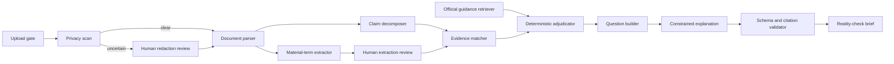
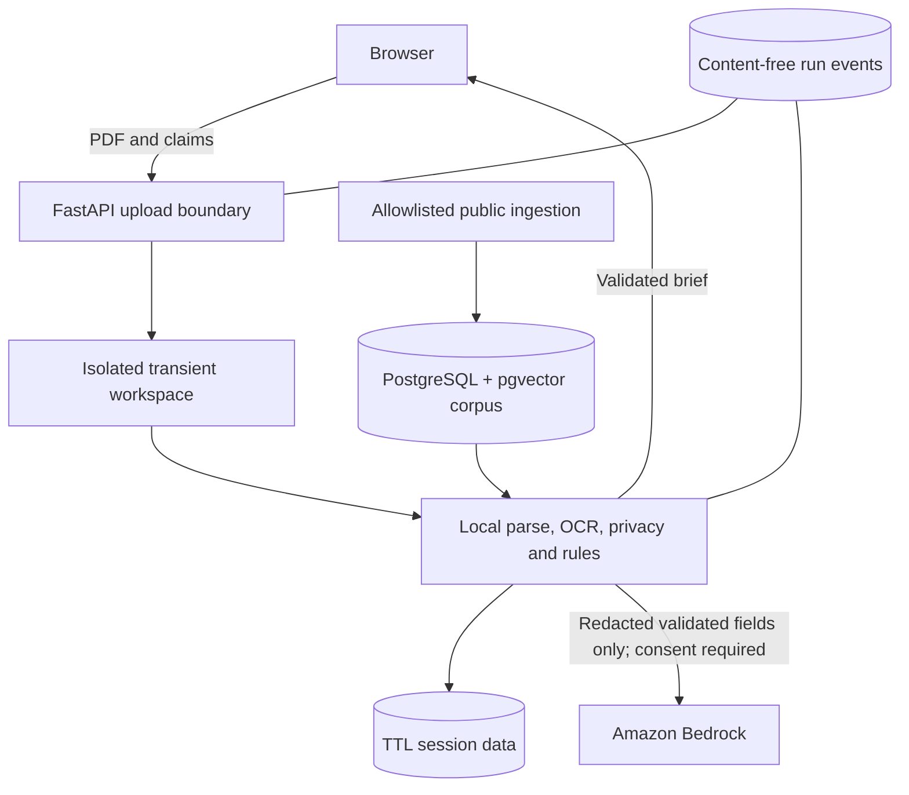
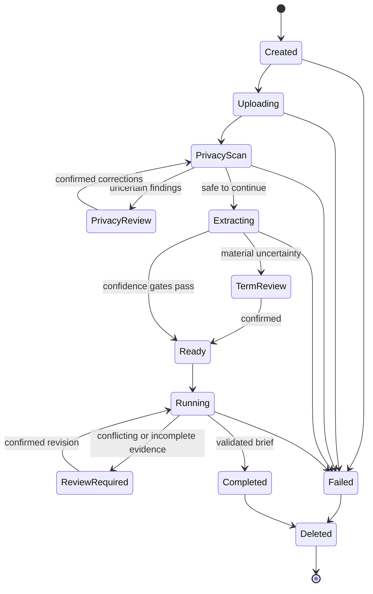

# Before You Commit: Product and Migration Plan

| Field | Value |
| --- | --- |
| Status | Active implementation; Phase 3 and initial Phase 6 slice in progress |
| Working title | Before You Commit |
| Product category | Financial commitment reality check |
| Initial market | Singapore |
| MVP commitment | Individual life-insurance offer or newly issued policy |
| Plan owner | Project team |
| Last updated | 2026-09-03 |
| Implementation authority | This file |

## 1. Plan authority

This is the sole active product, architecture, and migration plan for the repository. Superseded product documentation is historical and must not be used to make implementation decisions. The organizer brief and source material remain active constraints:

- [Hackathon training notes](docs/IGNITE-Agentic-AI-Hackathon-Training-Session.md)
- `docs/IGNITE_Agentic_AI_Hackathon_Functional_Training_Session_3_24_Aug.pdf`
- `docs/(Kick-off) Agentic AI Hackathon 2026_14 Aug.pdf`

No application migration begins until Gate 0 is approved. Once implementation starts, every material scope, architecture, contract, or acceptance decision must be reflected here before dependent work proceeds.

### Plan maintenance protocol

1. Read the current phase, decisions, and exit gate before starting a work item.
2. Keep phase status and the implementation ledger current in the same change as the work.
3. Record a decision here before introducing a new provider, persistent data class, agent capability, or public API.
4. Do not silently weaken privacy, evidence, deterministic-control, or human-review gates to meet a demo deadline.
5. Treat a failed exit gate as a stop condition, not as an item to defer without an explicit decision.

## 2. Product thesis

### Problem statement

A young adult in Singapore who has received a financial-product offer may be expected to commit after reading several dense documents and hearing verbal or written sales claims. At that moment, they need to know what the commitment actually requires, which important claims the documents support, which claims are conditional or absent, and what questions to resolve before signing or before a free-look deadline expires.

Discovery and comparison are already served by portals such as CompareFIRST and commercial aggregators. Generic policy summarisation is also an active product category. The unmet job addressed here is narrower:

> Turn the documents for one imminent financial commitment into an inspectable, evidence-backed reality check before the user acts.

### Target user and moment

The primary user is a first-time or low-confidence buyer, typically aged 19-35, who:

- has a genuine quotation, policy illustration, product summary, product highlights sheet, or newly issued policy;
- has been told one or more claims about cost, returns, coverage, flexibility, or cancellation;
- is considering signing, paying, replacing another product, or using a free-look right; and
- does not yet know which terms or questions are material.

The product is designed for the period between receiving documents and making or confirming the commitment. It is not a product catalogue and does not begin with a broad financial-literacy quiz.

### User promise

For a supported document bundle, the user receives:

1. A plain-language commitment snapshot with every material fact linked to its source page or section.
2. A cost and time view that separates guaranteed amounts, non-guaranteed illustrations, and unknowns.
3. A claim check that labels each user-entered or document-derived claim as supported, conditional, contradicted, not found, unreadable, or requiring external confirmation.
4. A list of missing documents, unresolved terms, and focused questions to ask the insurer or representative.
5. Relevant official guidance with URL, title, heading, retrieval date, and content hash.
6. A downloadable, non-prescriptive brief that the user can use during a follow-up conversation.

The system shows uncertainty rather than filling gaps. It never tells a user to buy, reject, cancel, surrender, replace, or select a product.

## 3. MVP boundary

### In scope

The MVP supports one Singapore individual life-insurance commitment at a time.

- Upload one or more genuine PDF documents from the same offer or issued-policy bundle.
- Accept text PDFs and scanned PDFs within published size and page limits.
- Detect document type and whether expected companion documents are missing.
- Extract material terms with page-level provenance and confidence.
- Let the user paste or type claims made by a representative or online journey.
- Identify material claims stated by the uploaded documents.
- Cross-check claims against the document bundle and contextualise them with allowlisted official sources.
- Calculate transparent payment totals and timelines only when the required inputs are present.
- Pause for user review when redaction or a material extraction is uncertain.
- Produce a source-backed question and action brief.
- Support correction, confirmation, rerun, replay, and undo within the active session.
- Run locally through Docker Compose with PostgreSQL and pgvector.
- Use Amazon Bedrock only for constrained plain-language rendering of validated inputs in the judged path.

### Supported MVP document classes

Priority order:

1. Policy illustration or benefit illustration.
2. Product summary.
3. Product highlights sheet for an investment-linked or bundled product.
4. Quotation or cover page.
5. Issued policy schedule and policy wording.
6. Bundled product disclosure or direct-purchase fact sheet.

The interface may accept an incomplete bundle, but the report must name missing expected documents and limit its conclusions accordingly.

### Not in scope

- Market-wide product search, ranking, lead generation, or affiliate links.
- Personalised suitability, needs analysis, regulated financial advice, or sales.
- A recommendation to purchase, cancel, surrender, switch, or replace a policy.
- Predicting claim approval, insurer behaviour, investment performance, bonuses, or future non-guaranteed values.
- Verifying a representative's identity or alleging mis-selling or fraud.
- Automatic submission of forms, complaints, cancellations, claims, or transactions.
- Portfolio-wide gap analysis or comparison across insurers.
- Permanent document vaults, accounts, broker workspaces, or social features.
- Credit-card, loan, lease, subscription, or employment commitments in the MVP.
- Bypassing authentication, CAPTCHA, MFA, paywalls, or access controls during evidence collection.

Credit-card and other commitment types are potential later verticals. They may reuse the pipeline only after the insurance MVP meets its exit gates; they do not expand the initial taxonomy or UI.

## 4. Differentiation

### Existing alternatives

- MoneySense and LIA publish strong educational guidance and buyer checklists, but do not transform a user's own document bundle into a traceable brief.
- CompareFIRST supports product discovery and side-by-side comparison, which is deliberately outside this product's core job.
- Policy-management services focus on storing portfolios, tracking coverage, and financial planning.
- Policy-analysis tools already offer summaries, clause extraction, gap flags, comparison, renewal tracking, and dispute workflows.

### Defensible wedge

The MVP must win on trust at the decision moment, not breadth:

- **Pre-commitment, not portfolio management:** one imminent decision and its deadline.
- **Claim verification, not generic summary:** compare what the user was told with what the supplied documents state.
- **Two evidence planes:** clearly distinguish uploaded-document evidence from general official guidance.
- **Unknowns are outputs:** absence, ambiguity, unreadable text, and external-only facts remain visible.
- **Privacy minimisation:** raw documents are transient by default and are not sent to an LLM.
- **Deterministic result ownership:** code assigns statuses and performs calculations; an LLM cannot change them.
- **Conversation-ready artifact:** questions are tied to unresolved terms and citations, not generated as generic advice.
- **Inspectable execution:** task state, evidence acceptance, revisions, and failures are traceable without logging private content.

## 5. Product experience

### Primary journey

1. **Set the moment**: choose “considering an offer” or “reviewing a newly issued policy”; enter a known decision or free-look date if applicable.
2. **Read the privacy contract**: see what is processed, retained, sent externally, and deleted before selecting files.
3. **Upload the bundle**: add supported PDFs and see type, page count, and validation status for each.
4. **Review privacy findings**: confirm or amend proposed redactions when identifiers or sensitive health details are detected.
5. **Add what was said**: type or paste claims such as “the returns are guaranteed” or “I can stop paying after ten years.” This step is optional but central to differentiation.
6. **Review extracted terms**: confirm low-confidence material fields; jump to the cited page for each field.
7. **Run the reality check**: execute bounded extraction, retrieval, classification, calculation, and explanation tasks.
8. **Inspect the brief**: review the commitment snapshot, claim matrix, costs, conditions, missing evidence, deadlines, and questions.
9. **Revise without losing history**: correct a term or claim, rerun affected tasks, see the delta, and undo the revision.
10. **Export or delete**: download the brief and explicitly end the session, triggering content deletion.

### Result information architecture

The result uses this order:

1. **Before you act**: deadline, blocked checks, and the three highest-priority unresolved questions.
2. **What you are committing to**: product identity, parties, premium, payment duration, policy duration, and key conditions.
3. **What was said vs what is written**: claim-by-claim status with source spans.
4. **Money over time**: deterministic totals and a guaranteed/non-guaranteed distinction.
5. **Limits and exit consequences**: exclusions, waiting periods, surrender or lapse implications, and changeability.
6. **What is missing or uncertain**: missing documents, unreadable pages, absent terms, and low-confidence fields.
7. **Questions to ask**: specific, neutral questions with the evidence that prompted each one.
8. **Official context**: separate citations to current official consumer guidance.
9. **Method and limitations**: parser versions, run time, source freshness, and non-advice boundary.

No overall score, star rating, traffic light, “good/bad” label, or purchase recommendation is shown. A readiness state describes evidence completeness only.

## 6. Privacy, safety, and regulatory boundary

### Data-handling contract

Before upload, the user must see and acknowledge the following defaults:

| Data class | Processing | Default retention | External transmission |
| --- | --- | --- | --- |
| Raw uploaded file | Isolated local processing workspace | Deleted at terminal run state and no later than 30 minutes after failure or abandonment | Never |
| Raw extracted text and page images | Memory or isolated temporary workspace | Same lifecycle as raw file | Never |
| Redacted text spans | Active analysis session | Deleted when the session expires or the user deletes it | Only with explicit model-processing consent |
| Confirmed structured findings | Active analysis session | Maximum 24-hour TTL in the POC; user can delete immediately | Selected fields may be sent to Bedrock with consent |
| Generated report | Returned to the browser | Not retained by default | No |
| Operational metadata | Database | 30 days for POC evaluation | No content, identifiers, filenames, or extracted text |
| Public guidance corpus | Database | Until refreshed or deleted | Public content only |

Implementation must make retention values configurable and enforce deletion in code. UI copy, API behaviour, database TTL, temporary-file cleanup, backups, logs, and model calls must agree.

### Required privacy controls

- Validate PDF magic bytes, MIME type, size, page count, encryption state, and parser success before processing.
- Generate server-side opaque names; never use an uploaded filename as a storage path.
- Isolate each analysis workspace and prevent path traversal or cross-run access.
- Detect names, NRIC or FIN patterns, contact details, addresses, policy numbers, account details, signatures, and health disclosures.
- Redact before any external model boundary. If redaction confidence is insufficient, stop for user review or continue in local-only mode.
- Exclude raw content, extracted text, claims, filenames, and model prompts from application and infrastructure logs.
- Do not use user documents for training, corpus ingestion, analytics content, or test fixtures.
- Provide immediate delete and automatic expiry; deletion must include temporary artifacts and derived session content.
- Bind every artifact to its analysis ID, input hash, schema version, and producing task.
- Treat uploaded documents as untrusted data, never as instructions. Embedded prompts cannot alter system policy or task routing.

The production-readiness gate requires a formal review against applicable Singapore PDPA obligations, including notification, consent, purpose limitation, protection, retention limitation, transfer limitation, access/correction where applicable, breach notification, and accountability. The POC disclaimer is not a substitute for these controls.

### Advice boundary

Allowed outputs:

- faithful document extraction and arithmetic;
- differences between a claim and supplied wording;
- neutral identification of conditions, exclusions, missing evidence, and questions;
- links and quotations from allowlisted official guidance; and
- referral to the insurer, representative, licensed financial adviser, or other appropriate official channel.

Disallowed outputs:

- suitability or affordability conclusions about the individual;
- directives to buy, cancel, surrender, replace, complain, or claim;
- legal conclusions, misconduct allegations, or guarantees of coverage or payout;
- invented deadlines, returns, exclusions, values, or document terms; and
- treating “not found” as proof that a statement is false.

## 7. Analysis model

### Material-term taxonomy

Every extracted field has a value state (`present`, `absent`, `unknown`, `unreadable`, or `not_applicable`), confidence, source spans, extraction method, and confirmation state.

| Category | MVP fields |
| --- | --- |
| Commitment identity | Insurer, product name, document types, issue/version date, policy or quotation status |
| Parties | Policy owner role, life assured role, payer role; identifiers are redacted and not reported |
| Premium | Amount, currency, frequency, payment duration, escalation, premium holiday or cessation conditions |
| Coverage term | Commencement, expiry or maturity, renewability, age limits, lapse conditions |
| Benefits | Benefit name, amount or formula, trigger, duration, stated conditions |
| Limitations | Exclusions, waiting periods, deferment periods, sublimits, deductibles, non-covered events |
| Value and returns | Guaranteed values, non-guaranteed illustrated values, assumptions, cash or surrender values |
| Investment features | Fund or allocation references, fees, risk statements, withdrawal and switching terms |
| Exit and change | Cancellation/free-look wording, surrender, partial withdrawal, reduced paid-up, reinstatement |
| Disclosure and underwriting | Material disclosure duties, pre-existing conditions, underwriting status, consequences stated |
| Distribution | Fees, commissions or distribution cost where disclosed; advice or no-advice channel |
| Missing evidence | Expected companion document, schedule, rider wording, endorsement, or definition not supplied |

### Claim taxonomy

Claims can be user-entered or extracted as prominent statements from supplied materials. A claim is decomposed into subject, predicate, value, units, time qualifier, conditions, and source.

| Status | Meaning |
| --- | --- |
| `supported` | The supplied bundle directly supports the full material claim. |
| `supported_with_conditions` | Wording supports it only under conditions that must be shown beside the status. |
| `contradicted` | Supplied wording directly conflicts with a material part of the claim. |
| `not_found` | The supplied bundle does not contain enough evidence; this is not a falsehood finding. |
| `external_confirmation_required` | Only the insurer, representative, underwriting outcome, future event, or another unavailable source can establish it. |
| `unreadable` | Relevant pages or spans could not be read reliably. |

The deterministic classifier assigns the status from accepted evidence and explicit rules. A model may propose claim decomposition and candidate spans, but it cannot issue the final status.

### Deterministic calculations

The MVP may calculate:

- total scheduled premiums over a known payment duration;
- annualised premium from an explicit frequency;
- premium timeline by policy year;
- difference between explicit guaranteed and non-guaranteed illustrated values; and
- explicit surrender-value difference from cumulative scheduled premium at selected years.

Every calculation returns its formula, inputs, units, rounding rule, source IDs, assumptions, and an “unable to calculate” result when inputs are missing. It must not extrapolate premiums, returns, bonuses, or values beyond documented inputs.

### Evidence completeness state

- `blocked`: no supported readable document or unresolved privacy review.
- `review_required`: a material field or claim depends on unreadable, conflicting, or low-confidence evidence.
- `complete_for_supplied_bundle`: all required checks ran against the supplied bundle, although external unknowns may remain.

This state measures process completeness, not product quality or suitability.

## 8. Evidence and RAG architecture

### Two evidence planes

1. **Private bundle evidence** comes only from the user's uploaded documents. It supports statements about this commitment and uses analysis-scoped source IDs, page numbers, bounding boxes where available, and hashes.
2. **Public guidance evidence** comes from a curated allowlist of official Singapore sources. It contextualises questions and consumer rights but cannot override or invent terms in the user's contract.

The UI and contracts must never merge these planes into an ambiguous citation list.

### Public corpus allowlist for MVP

- MoneySense consumer guidance.
- Monetary Authority of Singapore consumer or regulatory guidance relevant to the supported product class.
- Life Insurance Association Singapore consumer guides and codes.
- CompareFIRST explanatory and direct-purchase material where accessible.
- Personal Data Protection Commission guidance used for the product's own privacy controls, not for policy analysis.

Insurer marketing pages, blogs, aggregators, forums, and model-generated text are not authoritative public evidence in the MVP. Insurer documents supplied by the user remain private bundle evidence.

### WARDEN-derived retrieval design

Adapt the proven architectural patterns from the local WARDEN RAG repository without importing its Qdrant implementation:

- a storage-neutral `KnowledgeStore` boundary;
- normalized source, document, chunk, and retrieval-result models;
- heading-aware chunking with stable chunk hashes;
- retained URL, title, heading path, content hash, crawl timestamp, and source freshness;
- canonical-URL and content-hash deduplication;
- lexical PostgreSQL full-text search plus pgvector semantic search;
- reciprocal rank fusion for deterministic hybrid ranking;
- source allowlisting, freshness policy, and stale-source visibility;
- idempotent ingestion and index-version metadata; and
- explicit pause for authentication, MFA, SSO, or CAPTCHA.

Use PostgreSQL 16 and pgvector already present in the project. Crawling, parsing, embedding, indexing, and retrieval must remain testable without an LLM. An embedding provider may be configured, but lexical retrieval must provide a functional local fallback.

### Citation contract

Every accepted citation includes:

- `evidence_id` and evidence plane;
- analysis/document/chunk identifiers as applicable;
- page number and bounding box for private PDFs where available;
- URL, title, heading path, and publisher for public guidance;
- verbatim bounded snippet;
- content and chunk hashes;
- document issue/version date when available;
- crawl or upload timestamp;
- retrieval method and score; and
- parser, extractor, and index versions.

A result cannot cite a span whose content hash is not bound to the current input or corpus version.

## 9. Agentic orchestration

### Design rule

“Agent” means a bounded capability with a typed input, typed output, explicit evidence, scoped permissions, and a terminal state. It does not imply that every task uses an LLM. A single coordinator owns state transitions; capabilities do not call each other freely.

### Capability graph

### Capabilities

| Capability | Responsibility | Model allowed? | Required stop conditions |
| --- | --- | --- | --- |
| Upload gate | File validation, limits, workspace creation | No | Invalid, encrypted, oversized, malformed, unsupported |
| Privacy scan | Identify and redact personal/sensitive spans | Optional candidate detection only | Uncertain high-risk redaction |
| Document parser | Text, layout, page, table, and OCR extraction | No | Unreadable material pages |
| Material-term extractor | Produce typed candidate terms with provenance | Optional after redaction | Missing source span or invalid schema |
| Claim decomposer | Convert user/document statements to atomic claims | Optional after redaction | Ambiguous material meaning |
| Evidence matcher | Find supporting and conflicting private spans | Optional candidate generation | No hash-bound evidence |
| Guidance retriever | Retrieve current allowlisted public evidence | No | No qualifying evidence or stale-only result |
| Deterministic adjudicator | Assign claim and completeness states; calculate values | No | Conflicting accepted evidence or missing inputs |
| Question builder | Map unresolved terms to neutral question templates | No by default | No cited trigger for a question |
| Explanation renderer | Express validated results in plain language | Bedrock in judged path | Prompt/output validation failure |
| Output validator | Enforce schema, citations, prohibited language, and payload binding | No | Any invalid or unsupported output |

### AgentRelay-derived controls

Adapt the useful patterns from the local AgentRelay repository as Python domain concepts:

- coordinator-owned directed acyclic task graph;
- explicit task finite-state machine;
- capability registration and routing by declared input/output contract;
- immutable context capsules containing only data needed for one task;
- scoped grants for private-document, public-network, model, and persistence access;
- server-owned policy checks before every side effect;
- accepted-evidence records separate from agent messages;
- payload binding between task, input hashes, evidence, and output;
- append-only content-free run events and trace IDs;
- idempotency keys for upload, execution, revision, and deletion; and
- retry, timeout, cancellation, and recovery rules per capability.

Do not import the TypeScript control plane, Codex CLI runtime, container-per-agent model, or JSON persistence. The target remains a Python/FastAPI service with in-process capabilities for the POC.

### Task states

`pending -> ready -> running -> succeeded | review_required | blocked | failed | cancelled`

- Only the coordinator changes task state.
- Retries create a new attempt bound to the same immutable input capsule.
- A dependent task runs only on accepted, schema-valid upstream output.
- `review_required` resumes only with a recorded user confirmation or correction.
- Terminal cleanup runs even when execution fails or is cancelled.

## 10. Trust boundaries and runtime

Trust-boundary invariants:

- Raw uploads and raw extracted text never cross the local processing boundary.
- The public corpus never receives content from a user analysis.
- Bedrock receives no direct file, page image, personal identifier, policy number, signature, health disclosure, or unrestricted text block.
- Model output is untrusted until schema, citation, number, status, and prohibited-language validation pass.
- Browser-visible facts come from accepted artifacts, not task logs or free-form agent messages.
- Database records use opaque IDs and cannot expose another analysis.

### Runtime topology

Retain the current Docker Compose shape:

- Vite frontend for the user journey.
- FastAPI backend as API, coordinator, and policy-enforcement boundary.
- PostgreSQL 16 with pgvector for public evidence, run metadata, and TTL session findings.
- A bounded worker process for public-source refresh and heavy document parsing if required.
- Amazon Bedrock as a configurable explanation provider; deterministic fallback copy keeps local development functional.

No new distributed broker, vector database, agent runtime, authentication system, or cloud document store is justified for the MVP.

## 11. Versioned domain contracts

All contracts use Pydantic, reject unknown fields at trust boundaries, include `schema_id` and `schema_version`, and distinguish missing, unknown, absent, unreadable, and not applicable.

### Core entities

- `AnalysisSession`: purpose, stage, consent flags, deadlines, TTL, input hashes, and version set.
- `UploadedDocument`: opaque ID, type, hash, page count, parse state, and transient-artifact state.
- `PrivacyFinding`: category, source region, risk, action, confidence, and confirmation.
- `DocumentSpan`: document/page/region coordinates, redacted text, hash, and parser metadata.
- `MaterialTerm`: taxonomy key, typed value, state, confidence, source spans, and confirmation.
- `Claim`: atomic statement, origin, structured qualifiers, and confirmation.
- `ClaimAssessment`: status, reasons, supporting spans, conflicting spans, and unresolved conditions.
- `GuidanceEvidence`: normalized public citation and freshness metadata.
- `Calculation`: formula ID, inputs, result, units, rounding, assumptions, and sources.
- `Question`: neutral text, priority, trigger IDs, intended recipient, and resolution state.
- `RealityCheckBrief`: evidence-completeness state, snapshot, assessments, calculations, unknowns, questions, citations, and limitations.
- `TaskRecord`: capability, state, attempt, capsule hash, artifact IDs, timings, and error code.
- `RunEvent` and `RunMetrics`: content-free operational trace and evaluation data.
- `Revision`: parent version, confirmed patch, affected tasks, rerun result, and reversible delta.

### Proposed API surface

| Method | Endpoint | Purpose |
| --- | --- | --- |
| `POST` | `/api/v2/analyses` | Create a session and record purpose, deadline, and consent. |
| `POST` | `/api/v2/analyses/{id}/documents` | Stream one PDF through validation into transient storage. |
| `GET` | `/api/v2/analyses/{id}/documents` | Return metadata and processing states, never file content. |
| `POST` | `/api/v2/analyses/{id}/privacy-scan` | Run local privacy detection. |
| `PATCH` | `/api/v2/analyses/{id}/privacy-findings` | Confirm or amend redaction actions. |
| `POST` | `/api/v2/analyses/{id}/extract` | Parse and extract candidate material terms. |
| `PATCH` | `/api/v2/analyses/{id}/terms` | Confirm or correct reviewable terms. |
| `PUT` | `/api/v2/analyses/{id}/claims` | Replace the confirmed set of claims to check. |
| `POST` | `/api/v2/analyses/{id}/runs` | Execute the bounded analysis graph idempotently. |
| `GET` | `/api/v2/analyses/{id}/runs/{run_id}` | Read task states, safe events, metrics, and accepted result. |
| `GET` | `/api/v2/analyses/{id}/brief` | Read the current validated brief. |
| `POST` | `/api/v2/analyses/{id}/revisions` | Apply a confirmed change and rerun affected tasks. |
| `POST` | `/api/v2/analyses/{id}/undo` | Restore the preceding accepted revision. |
| `GET` | `/api/v2/analyses/{id}/export` | Generate a non-retained report. |
| `DELETE` | `/api/v2/analyses/{id}` | Delete transient and derived session content immediately. |
| `GET` | `/api/v2/system/health` | Report dependency health without private data. |

Uploads must be streamed and size-limited. Mutation endpoints require an idempotency key. Responses must use stable error codes rather than leaking parser, provider, or filesystem details.

### Analysis state machine

## 12. Active implementation disposition

The replacement vertical slice is now the only executable product path. Superseded product documentation remains isolated under `docs/archive/` and is not an implementation input.

| Surface | Current role | Next change |
| --- | --- | --- |
| `backend/app/contracts_v2.py` | Strict domain contracts and explicit value states | Extend only alongside the material-term, claim, evidence, and orchestration slices. |
| `backend/app/analysis_service.py` | Expiring in-memory analysis lifecycle | Move durable state through repository interfaces without weakening TTL or deletion. |
| `backend/app/document_service.py` | Streamed local PDF processing, OCR, privacy review, and artifact cleanup | Preserve the raw-content boundary while adding source inspection. |
| `backend/app/material_extraction.py` | Deterministic identity, premium, coverage-date, and free-look candidates with conflicts, unknowns, and review | Extend through benefits, limitations, values, investment, disclosure, distribution, and bundle-completeness rules. |
| `backend/app/api_v2.py` | Sole product API router | Add slices behind strict contracts and stable error envelopes. |
| `backend/app/main.py` | Health, CORS, v2 service wiring, and no product logic | Add lifecycle/repository wiring as phases require it. |
| `backend/app/scraper_worker.py` | Allowlisted official-guidance refresh worker | Connect normalized ingestion and `KnowledgeStore` in Phase 4. |
| `backend/docker/postgres-init.sql` | v2 evidence, task, session, revision, and metrics schema | Add repository migrations with deletion tests. |
| `frontend/src/api.js` | Canonical `/api/v2` transport | Add claims, run, source, export, revision, and expiry calls. |
| `frontend/src/main.js` | Document upload, privacy review, term review, summary, and deletion journey | Complete source inspection, claims, questions, export, and recovery states. |
| Docker and Compose | Local-first four-service runtime | Keep model access optional and private content local. |
| Tests and evaluation assets | v2 contract, route, document, extraction, cleanup, browser evidence, and versioned synthetic extraction baseline | Add representative adjudicated documents and the committed Playwright suite. |

The `/api/v2` slice is proven, the frontend has switched, and unreachable compatibility behaviour and synthetic fixtures have been removed. New work extends this boundary rather than restoring superseded product paths.

## 13. Migration phases and gates

### Phase status

| Phase | Status | Exit gate |
| --- | --- | --- |
| 0. Product and migration approval | Complete | Gate 0 approved 2026-09-03 |
| 1. Authority, vocabulary, and contract reset | Complete | Gate 1 passed 2026-09-04 |
| 2. Real-document and privacy proof | Complete | Gate 2 passed 2026-09-04 |
| 3. Material-term extraction | In progress | Gate 3 |
| 4. Official-evidence RAG | Not started | Gate 4 |
| 5. Claim adjudication and orchestration | Not started | Gate 5 |
| 6. End-to-end user journey | In progress (initial vertical slice) | Gate 6 |
| 7. Bedrock rendering and revisions | Not started | Gate 7 |
| 8. Hardening, evaluation, and demo | Not started | Gate 8 |

### Phase 0: Product and migration approval

Deliverables:

- Approve the problem, user moment, MVP document classes, non-goals, privacy defaults, and advice boundary.
- Approve the architecture and conceptual use of WARDEN and AgentRelay patterns.
- Resolve the Gate 0 decisions at the end of this plan.

**Gate 0:** Explicit project-owner approval. No application code or active README migration before approval.

### Phase 1: Authority, vocabulary, and contract reset

Deliverables:

- Update the active README and environment examples to the approved product language.
- Define Pydantic v2 contracts and stable error codes.
- Add contract tests for all value states, evidence planes, task states, and prohibited ambiguous defaults.
- Add database migration design and TTL/deletion semantics.
- Inventory all runtime paths tied to product discovery, comparison, ranking, and broad profile collection.

**Gate 1:** Contract tests pass; active docs and new schemas contain no product-ranking journey; deletion behaviour is specified down to each table and temporary artifact.

### Phase 2: Real-document and privacy proof

Deliverables:

- Stream genuine PDFs into isolated per-analysis workspaces.
- Validate type, size, page count, encryption, and malformed content.
- Extract text/layout locally and invoke OCR only for pages that need it.
- Detect and review seeded identifiers and sensitive spans.
- Prove cleanup on success, failure, timeout, cancellation, and process restart.
- Add a local-only path that makes no model request.

**Gate 2:** At least three structurally different authentic, non-personal or explicitly consented documents complete the path; 100% of seeded sensitive values are absent from logs, database content fields, and model requests; cleanup integration tests pass.

### Phase 3: Material-term extraction

Deliverables:

- Document classification and bundle completeness rules.
- Page/span model with bounding boxes where parser output supports them.
- Deterministic candidate extraction for dates, amounts, percentages, durations, and labelled tables.
- Optional redacted structured extraction for semantic fields.
- Review UI for every low-confidence material term.
- Versioned extraction fixtures and adjudicated expected outputs.

**Gate 3:** Critical-field citation precision is at least 95%, critical-field recall at least 90%, every accepted field is hash-bound to a source span, and no unknown field is silently coerced to zero or false.

### Phase 4: Official-evidence RAG

Deliverables:

- `KnowledgeStore` protocol and PostgreSQL implementation.
- Allowlisted source registry and crawl policy.
- Normalized ingestion with heading-aware chunks, URL/title/heading/hash/timestamp metadata, and idempotent refresh.
- PostgreSQL full-text, pgvector, and reciprocal-rank-fusion retrieval.
- Freshness, deduplication, stale-source, and no-evidence behaviour.
- Retrieval evaluation set based on the material-term and question taxonomy.

**Gate 4:** Citation integrity is 100%; at least 90% of evaluation questions have a relevant official source in the top five; stale or missing evidence is visible; retrieval works without an LLM.

### Phase 5: Claim adjudication and orchestration

Deliverables:

- Atomic claim input and confirmation.
- Evidence matching and conflict representation.
- Deterministic claim-status rules and bounded calculation engine.
- Coordinator DAG, task FSM, scoped grants, context capsules, artifact acceptance, idempotency, cancellation, and recovery.
- Content-free run event and metric emission.
- Human review pauses for privacy, extraction, and evidence conflicts.

**Gate 5:** An adversarial test suite proves that document instructions cannot alter task policy; claim-status gold-set accuracy is at least 90% with 100% citation binding; retries do not duplicate artifacts; failed or cancelled runs clean up private data.

### Phase 6: End-to-end user journey

Deliverables:

- Replace the current frontend journey with upload, privacy review, claim entry, term review, run progress, brief, and deletion views.
- Render PDF page/source inspection without exposing server file paths.
- Make unknown, not-found, conditional, and contradicted states visually and textually distinct.
- Implement responsive and accessible keyboard, focus, error, loading, empty, failure, and expiry states.
- Add Playwright coverage for desktop and mobile flows.

**Gate 6:** A new user can process a supported real document, inspect every material finding at its source, correct an extraction, obtain questions, export, and delete without facilitator help; no legacy journey is reachable.

### Phase 7: Bedrock rendering and revisions

Deliverables:

- Redacted, minimal Bedrock request contract and explicit consent enforcement.
- Structured explanation schema and validator.
- Number, citation, status, prohibited-language, and payload-binding checks.
- Deterministic fallback copy for provider failure or opt-out.
- Dependency-aware rerun, delta explanation, replay, and undo.

**Gate 7:** Bedrock changes no fact, number, status, or citation; seeded sensitive data never crosses the boundary; malformed or unsupported model output fails closed; revision and undo preserve immutable prior results.

### Phase 8: Hardening, evaluation, and demo

Deliverables:

- Security and privacy threat-model review.
- Parser resource limits, malicious-file cases, dependency scanning, and backup/retention verification.
- Evaluation corpus and scored report.
- Five-minute judged demo using an authentic public, non-personal policy document.
- Failure rehearsal for OCR uncertainty, no evidence, provider outage, and deletion.
- Updated deployment, operator, and contributor documentation.

**Gate 8:** All release thresholds below pass, the repository check and touched test suites are green, the demo runs from a clean checkout, and known limitations are visible in-product.

## 14. Testing and evaluation strategy

### Test corpus policy

- Use authentic public insurer or regulator documents where redistribution and testing are permitted.
- Team-owned genuine documents require explicit consent and must be redacted before becoming durable evaluation artifacts.
- Never commit user uploads or copied production content.
- Create synthetic variants only to exercise controlled PII, OCR corruption, conflicting clauses, and edge cases.
- Keep a manifest with document origin, permission, hash, document class, expected layout characteristics, and adjudication status.

### Test layers

| Layer | Required coverage |
| --- | --- |
| Contracts | Strict parsing, schema versions, unknown/absent/unreadable states, forward incompatibility |
| Upload security | MIME spoofing, malformed/encrypted/oversized PDFs, traversal names, duplicate upload, decompression/resource limits |
| Privacy | Seeded PII/health data, redaction review, logs, traces, database, model payload, export, TTL, deletion paths |
| Parsing/OCR | Text PDFs, scans, mixed pages, rotated pages, tables, footnotes, headers, multi-column layouts |
| Extraction | Gold fields, source spans, confidence thresholds, conflicting values, missing documents |
| Retrieval | Allowlist, freshness, dedup, lexical/vector/fusion ranking, citation hashes, no-evidence path |
| Rules | Every claim state, calculation formula, rounding, missing input, contradictory evidence |
| Orchestration | DAG ordering, grants, invalid artifacts, retry, timeout, cancellation, resume, idempotency, cleanup |
| Model gateway | Consent, minimised payload, schema failure, invented number/citation/status, prohibited advice language |
| API integration | Full state machine, isolation, revisions, undo, export, delete, stable errors |
| Browser | Real upload, review loops, source navigation, accessibility, mobile/desktop, failure recovery |
| Operations | Clean Compose start, health, migration, corpus refresh, provider outage, restart cleanup |

### Release thresholds

| Measure | MVP threshold |
| --- | --- |
| Supported-document completion | At least 90% across the adjudicated evaluation corpus |
| Critical-field citation precision | At least 95% |
| Critical-field recall | At least 90% |
| Claim-status accuracy | At least 90%; no accepted status without bound evidence |
| Citation integrity | 100% of displayed citations resolve to the hashed source used by the run |
| Sensitive-data leakage | Zero seeded sensitive values in logs, corpus, metrics, or external requests |
| Cleanup | 100% across success, failure, cancellation, expiry, deletion, and restart tests |
| Unsupported factual output | Zero in the release evaluation set |
| Accessibility | WCAG 2.2 AA checks for the core journey, with no serious automated violations |
| Performance | P95 under 90 seconds for a 30-page supported document on the reference demo machine |
| Reliability | Ten consecutive clean-checkout demo runs without manual repair |

### User-outcome evaluation

With at least eight representative participants, test whether the product changes decision readiness rather than merely producing text.

- At least 75% correctly identify premium amount/frequency/duration, one material limitation, and guaranteed vs non-guaranteed status after use.
- Median completion time is under five minutes for a supported document.
- At least 75% can name two specific follow-up questions grounded in their brief.
- At least 80% can distinguish document evidence, official guidance, and an unknown.
- No participant interprets the evidence-completeness state as a recommendation in moderated testing.

Capture task outcomes and comprehension, not clicks, time-on-page, fear, or conversion.

## 15. Observability and demo evidence

Run metrics are content-free and include:

- analysis/run/task opaque IDs;
- task state transitions, attempts, latency, and error codes;
- document class, page-count bucket, and parser/OCR path without filename or text;
- count of privacy findings by category, never values;
- extracted-term counts by state and confidence bucket;
- claim-status counts;
- public retrieval methods, source IDs, freshness, and citation validation;
- Bedrock invocation, model ID, token counts, latency, and validation outcome; and
- cleanup completion and deletion latency.

The demo evidence pack must show one trace from upload through deletion, one source-bound result, one human correction and rerun, one Bedrock validation record, and one privacy cleanup record. Operational dashboards must not display document content.

## 16. Risks and controls

| Risk | Impact | Control and decision |
| --- | --- | --- |
| Private data leaks to logs or models | Critical | Transient raw data, local redaction first, explicit consent, payload allowlist, seeded leakage tests, content-free observability |
| PDF exploit or resource exhaustion | High | Parser isolation, strict limits, patched libraries, timeouts, page caps, malformed-file tests |
| OCR or table extraction changes a material value | High | Source spans, confidence gates, deterministic numeric parsing, user review, no conclusion from low-confidence values |
| Prompt injection embedded in a document | High | Treat all document text as data, fixed task policy, scoped grants, structured outputs, adversarial tests |
| Model hallucinates facts or advice | High | Validated inputs, immutable statuses, citation/number validator, prohibited-language check, deterministic fallback |
| “Not found” is perceived as false | High | Separate status and copy, bundle-completeness check, visible limitations and external-confirmation state |
| Product crosses into regulated advice | High | No suitability/ranking/directives, neutral templates, review with qualified Singapore counsel before public release |
| Official guidance becomes stale | Medium | Version/date metadata, refresh policy, stale visibility, source allowlist |
| Authentic documents are too variable | High | Narrow document classes, adjudicated corpus, stop conditions, phased expansion only after metrics pass |
| Free-look date is calculated incorrectly | High | Prefer explicit user/document date, show assumptions, never invent receipt date, direct confirmation with insurer |
| Agent complexity obscures failure | Medium | One coordinator, bounded capabilities, accepted artifacts, explicit FSM, content-free traces |
| Demo depends on external providers | Medium | Pre-index public corpus, deterministic fallback, public non-personal demo file, provider health preflight |
| Scope expands to every financial product | High | Insurance-only MVP and Gate 8 before another taxonomy is introduced |
| Existing runtime and schemas cause migration regressions | Medium | `/api/v2` strangler path, vertical slices, contract tests, frontend switch before dead-path removal |

## 17. Reference sources informing this plan

Official product and consumer guidance:

- [MoneySense: Insurance basics](https://www.moneysense.gov.sg/insurance-basics/)
- [MoneySense: What to ask before buying life insurance](https://www.moneysense.gov.sg/what-to-ask-before-buying-life-insurance/)
- [MoneySense: Buying life insurance online](https://www.moneysense.gov.sg/buying-life-insurance-online/)
- [MoneySense: Buying Direct Purchase Insurance](https://www.moneysense.gov.sg/buying-direct-purchase-insurance/)
- [CompareFIRST](https://www.comparefirst.sg/wap/homeEvent.action)
- [Life Insurance Association Singapore consumer guides](https://www.lia.org.sg/tools-and-resources/consumer-guides/)
- [Personal Data Protection Commission: PDPA overview](https://www.pdpc.gov.sg/overview-of-pdpa/the-legislation/personal-data-protection-act)

Adjacent product scan used to avoid a generic summariser:

- [PolicyPal](https://www.policypal.com/)
- [Vantage](https://vantagewatch.app/)
- [MyPolicyReview.ai](https://mypolicyreview.ai/)

Architecture pattern sources:

- Local WARDEN RAG repository: normalized evidence, `KnowledgeStore`, provenance, heading-aware chunks, hybrid retrieval, freshness, deduplication, and authentication pauses.
- Local AgentRelay repository: coordinator DAG, task state machine, capability routing, evidence acceptance, scoped grants, payload binding, traces, approvals, and recovery.

External pages are research inputs, not runtime dependencies. Before implementation, pin an evidence-source registry with owner, purpose, authority tier, access method, and refresh policy.

## 18. Gate 0 decisions for review

The recommended defaults are included so review can approve or replace each decision explicitly.

| Decision | Recommended default |
| --- | --- |
| Product name | Use “Before You Commit” as a working title; defer branding until the end-to-end journey is proven. |
| MVP vertical | One Singapore individual life-insurance offer or newly issued policy bundle. |
| Genuine files | Support real user PDFs in the product; use authentic public non-personal documents for committed tests and the judged demo. |
| Claim input | User can paste/type claims; extracting prominent document claims is supplementary. |
| Raw retention | Never retain by default; delete at terminal state, with a 30-minute crash/abandonment ceiling. |
| Derived retention | Keep redacted confirmed session findings for at most 24 hours in the POC; immediate delete remains available. |
| Model boundary | No raw documents; only consented, redacted, validated structured facts and bounded evidence snippets reach Bedrock. |
| Result stance | Evidence completeness and questions only; no score, recommendation, suitability, or ranking. |
| Evidence corpus | Allowlisted Singapore official guidance only for MVP public RAG. |
| Architecture reuse | Adapt WARDEN and AgentRelay patterns into the existing Python/PostgreSQL stack; do not import either runtime wholesale. |
| Migration strategy | `/api/v2` is the sole product path; extend it by tested vertical slices without restoring superseded behaviour. |
| Next vertical | Do not begin credit-card or other commitment support before Gate 8. |

Gate 0 was approved by the project owner on 2026-09-03. Later phases still
require their stated evidence and exit gate.

## 19. Implementation ledger

| Date | Phase | Change | Evidence | Decision/gate |
| --- | --- | --- | --- | --- |
| 2026-09-03 | 0 | Archived superseded product documentation and established this root plan. | Active documentation inventory and repository status check. | Gate 0 approved by project owner. |
| 2026-09-04 | 1 | Added strict v2 domain contracts, expiring analysis lifecycle routes, eight-table PostgreSQL schema, active product identity, and migration inventory. | Eight v2 tables verified in PostgreSQL; contract and analysis-route tests pass; active README and v2 schemas contain no comparison or ranking journey. | Gate 1 passed; temporary compatibility remained until the replacement browser journey was proven. |
| 2026-09-04 | 2 | Added streamed PDF upload, opaque per-analysis workspaces, magic/MIME/size/page/encryption validation, text extraction, local OCR fallback, content deduplication, payload-bound idempotency, deterministic privacy detection/review, and deletion/expiry/cancellation/restart cleanup. | 17 v2 tests pass together; seeded values cover all eight privacy categories and are absent from API responses and captured logs; Pylance reports no touched-file errors. Three operator-supplied public insurer PDFs of 1, 13, and 3 pages completed the local validator with zero model requests and confirmed cleanup. The then-current backend suite had 65 passing tests and one isolated superseded conversation assertion. | Gate 2 passed; Phase 3 may begin. |
| 2026-09-04 | 3, 6 | Added deterministic, source-bound extraction and confirmation for premium amount, payment frequency, and payment duration, including explicit unknown and conflict states. Replaced the active browser journey with responsive upload, privacy review, term review, reviewed summary, immediate deletion, and canonical `/api/v2` transport. Compose database URLs now follow the configured PostgreSQL role and database without changing the user-owned `.env`. | 27 focused v2 tests passed before compatibility removal. The production frontend bundle is 24.40 kB (8.43 kB gzip) excluding CSS and imagery. An authentic public eight-page insurer PDF completed all six workflow requests with `2xx` responses and deletion with `204`; desktop and 390 x 844 mobile checks had no console errors, every stage started at scroll position zero, mobile actions did not cover review rows, and zero transient workspaces remained after cleanup. | Phase 3 and Gate 3 remain open for the complete taxonomy, adjudicated extraction corpus, and precision/recall thresholds. Phase 6 and Gate 6 remain open for claim entry, source inspection, questions, export, failure/expiry states, and committed Playwright coverage. |
| 2026-09-04 | 3, 6 | Removed the detached compatibility API, comparison-era domain modules, capability modes, tests, and synthetic fixtures after browser acceptance. Reduced the app factory to health plus `/api/v2`, made model configuration optional, archived the detached catalogue scraper and brochure extraction tree, removed unused frontend assets, and excluded archived data from the production backend image. | Every remaining backend test passes: 31 passed in Docker. OpenAPI asserts that no superseded product route is exposed. Active source, tests, Compose, scripts, root README, and repository memory notes describe only the replacement path; archived history remains isolated. Compose configuration and the v2-only backend image build successfully. | Replacement runtime migration complete. Continue Gate 3 and Gate 6 work only on the active v2 boundary. |
| 2026-09-04 | 3 | Expanded deterministic extraction to explicit insurer, product, document type, issue date, policy status, premium escalation, coverage commencement/end, and free-look fields. Tightened person-name privacy detection so product labels are not treated as personal names. Added a five-case versioned synthetic adjudicated corpus and threshold evaluator. | 22/22 expected facts matched exactly, 38/38 omitted facts remained explicitly unknown, and 22/22 accepted facts were bound to the expected source span; precision, recall, unknown accuracy, and citation binding were each 1.0. The full active backend suite passes with 33 tests and the frontend production build succeeds. | Synthetic baseline established. Gate 3 remains open for representative adjudicated documents, remaining material-term categories, table extraction, and review thresholds. |
| 2026-09-04 | 2, 3, 6 | Restricted health-information detection to explicit person-specific medical fields, grouped privacy choices by category with the safest action preselected, rewrote the browser journey in plain language, separated found facts from follow-up questions, and added deterministic brochure wording support. | The four-page repository AIA Hospital Income PDF produced zero privacy findings, five source-bound facts, and seven explicit follow-up questions in the live browser. A simulated response with 140 health findings across 24 pages rendered as one category with three radio choices and no dropdowns. Desktop and 390 x 844 mobile checks had no horizontal overflow; the production frontend build succeeds; diagnostics are clean; and all 35 backend tests pass in Docker. | The reported false-positive and review-overload failure modes are covered. Gates 3 and 6 remain open for the planned taxonomy, representative corpus, source inspection, export, failure states, and committed Playwright coverage. |
