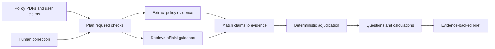

# Hackathon Competitiveness Review

## Executive verdict

The current implementation is a strong technical foundation, but it is not yet
likely to win the hackathon.

The user-visible product is currently close to an evidence-conscious field
presence checker. It accepts a policy PDF, protects personal details, extracts
12 predefined terms, shows the source page for values it finds, and turns
missing values into follow-up prompts. That is useful, but it does not yet
deliver the more compelling product promise: checking whether important things
a customer was told are actually supported by their policy documents.

The central issue is not code quality. The issue is that the most differentiated
parts of the proposed product remain in the plan rather than in the runtime:

- claim input and claim decomposition;
- claim-to-document evidence matching;
- supported, contradicted, conditional, and not-found adjudication;
- official-guidance retrieval;
- visible planning and adaptive orchestration;
- transparent financial calculations;
- revision-aware reruns; and
- an exportable evidence-backed brief.

Adding more extraction fields alone would make the current checker broader, but
would not make the demo meaningfully more agentic or more competitive.

## What the current product actually does

### Real-document handling

The application has credible document-processing foundations:

- genuine PDF upload rather than pasted sample text;
- file signature, MIME type, size, page-count, encryption, and malformed-file
  validation;
- local PyMuPDF extraction;
- local OCR fallback for scanned pages;
- isolated temporary workspaces;
- content hashing and payload-bound idempotency; and
- deletion and expiry behavior for temporary document copies.

These controls make the prototype more trustworthy and production-minded than
a typical hackathon PDF demo.

### Privacy review

The application detects eight categories of private information and allows the
user to hide it, exclude affected lines, or keep it locally. Redacted text is
used for subsequent extraction.

The privacy experience was corrected after realistic testing:

- generic brochure words such as "health", "treatment", and "cancer" no
  longer count as personal health disclosures;
- health detection is limited to explicit person-specific medical fields;
- findings are grouped by category rather than rendered as one control per
  occurrence; and
- a simulated response containing 140 health findings across 24 pages renders
  as one decision with three choices and no dropdowns.

This is a meaningful differentiator, although it supports the main product
rather than constituting the main value proposition by itself.

### Material-term extraction

The active extractor uses deterministic patterns for 12 fields:

1. Premium amount
2. Premium frequency
3. Premium payment duration
4. Insurer
5. Product name
6. Document type
7. Issue date
8. Policy status
9. Premium escalation
10. Coverage commencement
11. Coverage expiry or maturity
12. Free-look period

Values are represented as present, absent, unknown, unreadable, or not
applicable. Present values must be connected to source spans. Unknown values are
not silently converted to zero or false.

This is better than unconstrained model extraction because the behavior is
repeatable and inspectable. However, most of the active extraction remains
label or wording matching. From a user's perspective, the product still mostly
answers "Is field X present?"

### Current browser journey

The browser supports:

1. Selecting the review purpose
2. Uploading policy PDFs
3. Confirming local-processing consent
4. Reviewing privacy categories
5. Reviewing extracted terms
6. Separating found facts from missing details
7. Confirming the result
8. Deleting the check and temporary files

The copy now explains the product plainly and avoids product-development or AI
jargon. The interface is responsive and has been exercised at desktop and
390 x 844 mobile sizes.

### Engineering quality

The implementation also includes:

- strict Pydantic contracts;
- an explicit analysis state machine;
- stable error envelopes;
- mutation idempotency;
- deterministic behavior without a mandatory model;
- a v2-only API surface;
- Docker Compose deployment;
- regression and route tests; and
- a synthetic extraction evaluation baseline.

The current backend suite has 35 passing tests. The production frontend build
succeeds, and the live web and API services have passed health checks.

## Why it is not yet a winning submission

### 1. The visible outcome is too shallow

The result tells the user which predefined fields were found and which were not.
It does not tell the user whether a consequential statement is supported by the
policy, contradicted by it, subject to a condition, or missing from the supplied
bundle.

For example, the user cannot currently enter:

- "My premium never increases."
- "I can cancel within 14 days."
- "The payout is guaranteed."
- "I only need to pay for ten years."

Without that input, the application cannot perform the reality check described
by the product concept.

### 2. The agentic behavior is not demonstrated

The hackathon material asks teams to showcase knowledge of agentic AI and to
demonstrate a system that plans, acts, and adapts.

The current runtime follows a fixed linear workflow:

```text
upload -> privacy scan -> extraction -> term review -> summary
```

It has state and human-review pauses, but it does not visibly:

- formulate a task plan from the user's claims;
- choose tools based on the claim and available documents;
- retrieve missing context from an official source;
- reconcile conflicting evidence;
- revise its plan after a human correction; or
- rerun only the affected downstream work.

This makes it difficult to distinguish the demo from a conventional document
parser with a polished workflow.

### 3. There is no claim adjudication

The contracts and plan describe claim assessments, but the active API does not
accept claims and does not generate a claim matrix.

The missing core states are:

- supported;
- contradicted;
- conditional;
- not found; and
- review required.

These states, connected to exact document evidence, would create the product's
most important decision-support moment.

### 4. Official-guidance RAG is not active

The plan separates private policy evidence from public official guidance. That
is a strong architecture and trust story, but it is not yet implemented.

The current worker can inspect the source registry, but approved-source fetching
is explicitly disabled. There is no active ingestion, chunking, embedding,
retrieval, freshness check, or browser presentation for MoneySense, MAS, LIA, or
other allowlisted official guidance.

As a result, the application cannot show:

> Your policy says X. Here is the relevant official consumer guidance explaining
> what that term means and what you may want to clarify.

### 5. There is no calculation engine

When amount, payment frequency, and payment duration are present, the product
does not calculate the total nominal commitment. It also does not show formulas,
assumptions, escalation effects, or guaranteed versus non-guaranteed values.

A small deterministic calculation would provide a much stronger reveal than a
longer list of extracted fields.

### 6. Missing fields are not yet useful enough

The revised interface correctly presents missing fields as questions rather
than proof of absence. However, the questions remain close to field labels.

The product should generate a short, prioritized list such as:

- "Is the premium guaranteed to stay at this amount for the full payment term?"
- "Which document states the free-look deadline for this issued policy?"
- "Are any illustrated values non-guaranteed, and where are the assumptions?"

Each question should explain what triggered it and link to relevant policy or
official evidence.

### 7. The user cannot take the result away

There is no downloadable brief containing the checked claims, findings, source
pages, official guidance, calculations, questions, limitations, and timestamp.
The session can be deleted, but the user cannot retain a useful artifact first.

## Rubric assessment

The official rubric gives equal weight to benefits delivered, originality,
effectiveness, technical quality and superiority, and presentation.

The following estimate is an engineering assessment, not a prediction of the
judges' exact scoring.

| Criterion | Estimated score | Assessment |
| --- | ---: | --- |
| Benefits delivered | 12/20 | The benefit is understandable, but the product addresses only a shallow part of the decision. |
| Original or innovative idea | 7/20 | Privacy-conscious PDF checking is useful, but field extraction and document checklists are common. |
| Effectiveness | 8/20 | It extracts selected terms but does not verify what the customer was told or resolve the core uncertainty. |
| Technical quality and superiority | 14/20 | Local processing, OCR, privacy controls, deterministic states, lifecycle management, and tests are solid. |
| Presentation | 13/20 | The interface is clear, but the demo currently lacks a memorable reasoning or adaptation moment. |
| **Estimated total** | **54/100** | A functional middle-tier submission rather than a likely winner. |

The strongest category today is technical quality. The weakest categories are
originality and effectiveness because the differentiated product behavior is
not yet running.

## What a competitive version should demonstrate

The winning product should answer this question:

> Are the important things I was told actually supported by the documents I am
> about to sign?

A compelling five-minute demonstration would follow this sequence.

### 1. Upload a real policy bundle

The user uploads a brochure, benefit illustration, policy schedule, or contract.
The existing local parsing and privacy workflow remains in place.

### 2. Capture what the user was told

The user enters two or three short claims, for example:

- "My premium never increases."
- "I can cancel within 14 days."
- "The payout shown here is guaranteed."

An optional model may decompose informal text into atomic claims, but the user
must confirm those claims before assessment.

### 3. Plan the checks

The coordinator determines which capabilities each claim needs:

- relevant policy-term extraction;
- document evidence search;
- official-guidance retrieval;
- calculation; and
- human review for conflicts or uncertainty.

The plan should be visible enough that judges can understand why the system is
agentic without exposing implementation logs.

### 4. Match claims to exact evidence

For each claim, the system finds supporting and conflicting passages and binds
the result to the PDF page, bounding box, text hash, and document identity.

The user can open the exact highlighted source rather than trusting a generated
summary.

### 5. Retrieve official guidance separately

The system retrieves current guidance only from an allowlist of authoritative
Singapore sources. Public guidance is shown separately from private policy
evidence and never overrides what the contract says.

### 6. Apply deterministic adjudication

Rules assign one of the following states:

- **Supported:** the supplied documents directly support the claim;
- **Contradicted:** accepted evidence directly conflicts with the claim;
- **Conditional:** the claim is true only under stated conditions;
- **Not found:** the supplied bundle does not contain enough evidence; or
- **Review required:** evidence is unreadable, ambiguous, or conflicting.

A model may help locate candidate passages or write plain-language explanations,
but it must not decide the final status, change numbers, or invent citations.

### 7. Show one transparent calculation

When the necessary inputs are confirmed, calculate the nominal financial
commitment and show the formula. For example:

```text
S$100 per month x 12 months x 20 years = S$24,000
```

Any exclusions, escalation assumptions, and non-guaranteed values must remain
visible.

### 8. Produce prioritized questions

The output should identify the three most important unresolved issues and turn
them into concrete, neutral questions for the insurer or adviser. Each question
should cite what is missing, conditional, or conflicting.

### 9. Adapt after a correction

The user corrects one extracted term or rejects one candidate passage. The
coordinator invalidates only dependent assessments and calculations, reruns the
necessary tasks, and explains what changed.

This is the clearest demonstration that the system adapts rather than merely
executing a fixed pipeline.

### 10. Export and delete

The user downloads a concise evidence-backed brief and then deletes the session.
The brief should contain facts, claim assessments, calculations, questions,
citations, limitations, and a timestamp. It must not contain a product ranking
or recommendation.

## Target agentic flow



## Highest-leverage implementation order

### Priority 1: Claim input and assessment

Add a user-facing "What were you told?" step and an API for confirmed atomic
claims. Implement claim-to-span matching and the five deterministic assessment
states.

This changes the product from a document field extractor into a reality check.

### Priority 2: Source inspection

Let the user open every accepted finding at the exact PDF page and highlighted
passage. Preserve page, bounding box, document hash, and span hash through the
assessment path.

This creates the trust moment judges can see immediately.

### Priority 3: One official-guidance retrieval path

Implement the complete allowlisted ingestion and retrieval path for a narrow set
of high-value topics such as free-look periods, guaranteed versus
non-guaranteed values, and surrender implications. Include URL, title, heading,
content hash, crawl time, and freshness state.

Do not present copied snippets as a hardcoded approximation of RAG. A narrow but
real retrieval path is more credible.

### Priority 4: Questions and one calculation

Generate prioritized questions from unresolved assessments and add one
transparent premium-commitment calculation with explicit assumptions.

This turns evidence into action without crossing into product advice.

### Priority 5: Adaptive rerun and export

After a user correction, rerun only dependent work and show the resulting delta.
Then export the final evidence-backed brief before deletion.

This supplies both the adaptation demonstration and a useful user artifact.

## What not to prioritize

Before the core assessment loop works, do not spend the remaining hackathon time
on:

- expanding from 12 fields to a very large flat taxonomy;
- adding broad support for unrelated financial products;
- building a general-purpose chatbot;
- allowing a model to determine factual status or calculations;
- adding decorative agent animations with no underlying task behavior;
- ranking or recommending policies; or
- automating access-control, authentication, CAPTCHA, or consent bypasses.

These additions would increase scope without addressing the main competitive
gap.

## Recommended product boundary

The narrow scope remains a strength if the end-to-end check is deep:

- one imminent life-insurance commitment;
- one uploaded document bundle;
- a small number of user-confirmed claims;
- exact private-document evidence;
- narrowly relevant official Singapore guidance;
- deterministic status and calculations;
- neutral questions rather than recommendations; and
- complete local privacy and deletion controls.

The system should not score products, decide suitability, or tell the user to
buy, cancel, switch, or surrender a policy.

## Final assessment

The work completed so far should be retained. Real-document handling, privacy,
explicit unknowns, source-bound terms, lifecycle controls, and usability are the
right foundation for a trustworthy product.

However, the current application demonstrates infrastructure quality more than
agentic decision support. In its present form, it is unlikely to win because the
main interaction still resembles a simplified "field X present or absent"
check.

The shortest path to a competitive submission is not more extraction. It is one
excellent, fully working claim-adjudication loop:

1. capture what the user was told;
2. plan the checks;
3. find exact private and official evidence;
4. assign a deterministic, cited status;
5. calculate one meaningful commitment;
6. generate prioritized questions;
7. adapt after a human correction; and
8. export the evidence-backed brief.

If that complete scenario works reliably with an authentic policy document, the
existing engineering foundation becomes an advantage rather than hidden effort.