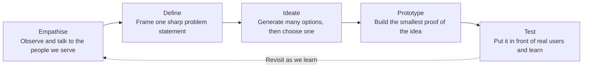
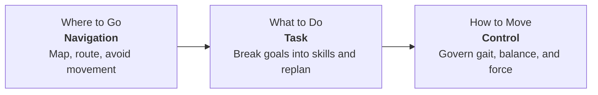
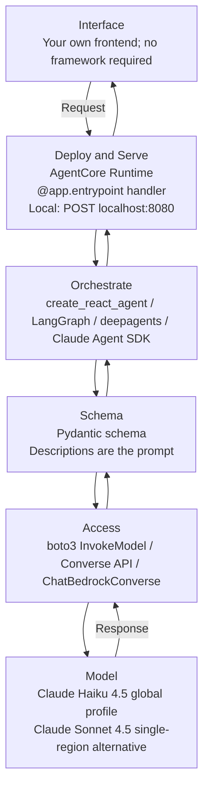
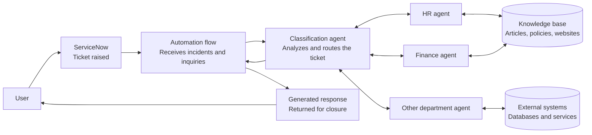
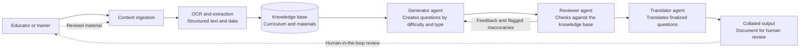
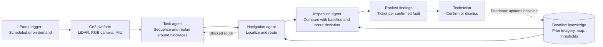
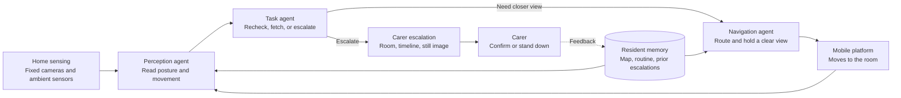
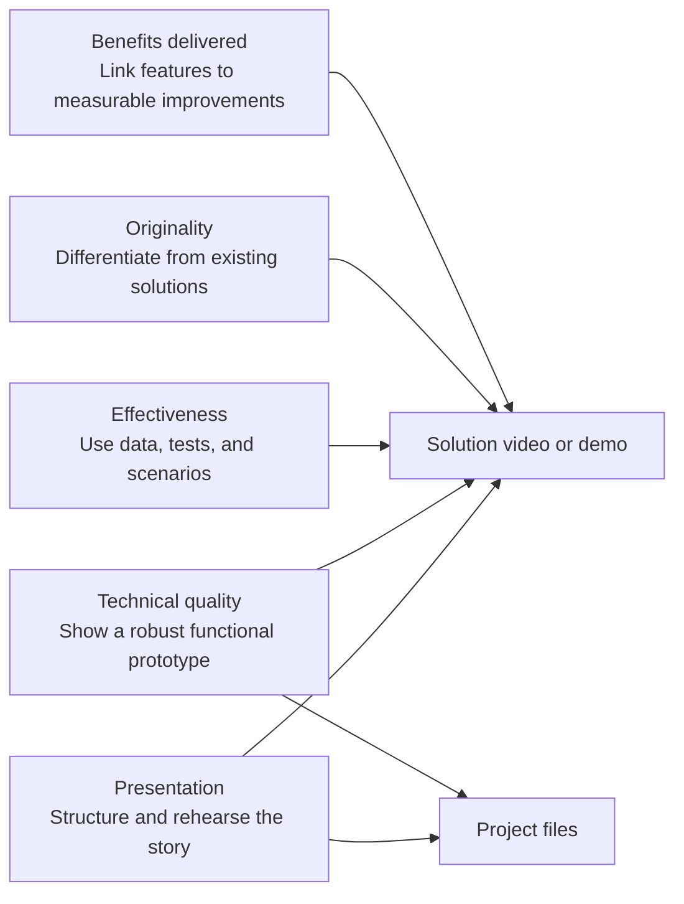
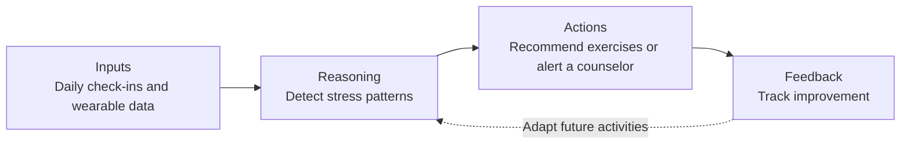

# IGNITE Agentic AI Hackathon 2026

> **Theme:** Fueling Tomorrow's Changemakers  
> **Source:** [IGNITE Agentic AI Hackathon Functional Training Session](IGNITE_Agentic_AI_Hackathon_Functional_Training_Session_3_24_Aug.pdf)  
> **Organizations shown on the cover:** SimplifyNext, NUS Centre for Future-ready Graduates, Nanyang Technological University Singapore, Singapore Management University, and Singapore University of Technology and Design.  
> **Copyright:** Copyright (c) 2026 SimplifyNext.

> **Cover visual (PDF page 1):** A neon-lit futuristic city frames a white title panel. The image establishes a technology-and-transformation theme; it does not add procedural content.

## Agenda

_PDF page 2_

1. Tackling the Problem Statement
2. Agent Classes
3. Best Practices
4. Case Studies and Measuring Performance
5. Presentation Prep and Submission Guidelines
6. Q&A

---

# Topic 1: Tackling the Problem Statement

> **Section-divider visual (PDF page 3):** Interlocking colored wooden blocks represent assembling a well-framed problem from distinct pieces.

## Problem Statement Recap

_PDF page 4_

### Design for a World in Transformation

Change is everywhere: in how we live, learn, and relate to one another. Transformation takes time, effort, and the right support at the right moment.

This is your chance to build something that helps. We envision a solution that **plans, acts, and adapts over time**.

Your team will choose the problem and decide whom it serves. You will design a solution that thinks ahead, takes action, and leaves people genuinely better off.

> **Supporting visual:** Interlocking puzzle pieces represent finding the missing connection needed to support change.

## Design Thinking: Framing the Problem Statement

_PDF page 5_

### Point-of-View Format

> **[User] needs [a way to ...] because [insight].**

**Worked example:**

> A caregiver needs a reliable way to track daily medication because missed doses lead to avoidable hospital visits.

**Pressure test:**

- **Good:** Names a real user, a real need, and the evidence.
- **Avoid:** Names a tool, a feature, or a technology.

Agree on one problem statement first.

## Six Ways a Problem Statement Fails

_PDF page 6_

Every failure mode below can sound convincing in a room but collapse under a judge's first question. Check all six before writing code.

| Failure mode | Why it fails | Weak example | Better direction |
|---|---|---|---|
| The Solution in Disguise | It describes the build before the design work is done. | "Students need an AI chatbot for course advice." | Name the person and the moment they are stuck. |
| The Everyone Problem | The user is all humanity, so no design decision follows. | "People need better access to mental health support." | Choose one person you can picture and describe. |
| The Missing Because | It asserts a need without evidence. | "Elderly residents need companionship." | Find evidence, then write the insight it supports. |
| The Boiling Ocean | It is true, enormous, and impossible to move in four days. | "Singapore needs a sustainable food supply chain." | Cut one slice you can finish and demonstrate. |
| The Solved Problem | A mature product already solves it well, setting an unrealistic bar. | "Commuters need to know when the next bus arrives." | Identify what existing tools still leave undone. |
| The Comfortable Guess | It comes entirely from the team's imagination. | "Job seekers need help writing resumes." | Talk to two real users and rewrite the statement afterward. |

**Fast check:** Read the statement aloud to someone outside the team. If they ask what you are building, the statement is still doing its job: it describes the problem rather than the solution.

## Weak to Sharp: Rewriting the Statement

_PDF page 7_

Square brackets mark evidence still owed. Every bracket needs a source and date before the statement is finished.

| Weak statement | What is missing | Sharper version |
|---|---|---|
| "People need better access to mental health support." | No named user, moment, or evidence. | A polytechnic student in their first semester needs a way to reach a counsellor the same day, because the wait for a first appointment runs **[N weeks, cite source]** and distress peaks in the fortnight before exams. |
| "Elderly residents need an AI companion robot." | It assumes the technology. | An older adult living alone needs someone to notice within the hour that they have fallen, because **[cite: share of lasting harm attributed to delay before help arrives]**. |
| "Businesses need to be more efficient with documents." | The user is a category and the need is abstract. | A claims officer needs the matriculation number and incident date lifted from scanned forms automatically, because keying them by hand takes **[N minutes per claim]** and the errors surface **[N weeks]** later. |
| "Students need help with career planning." | It applies to almost everyone and guides no decision. | A final-year student two months from graduation needs to see which roles their electives qualify them for, because **[cite: proportion graduating into unrelated work]**. |

Each sharper version names **one person, one moment, and one piece of evidence**.

## Pressure-Testing Your Statement

_PDF page 8_

Any "no" answer sends the team back to **Empathise** before code is written.

1. **Can we name one person?** Use a role at a specific moment, vivid enough to picture them walking into the room. "Users" and "people" do not pass.
2. **Can we cite the evidence?** Include a figure, source, and date. If support is only "it feels true," it is an assumption to test.
3. **Would that person recognize themselves?** Speak with at least one real person in that role. A statement written only from imagination often describes the team instead.
4. **Does it survive a different solution?** It should remain true if another team builds something completely different.

Question 4 is the sharpest test. If the statement only makes sense after describing your build, it has become a product pitch and should be rewritten.

## Where Agentic AI Belongs in the Story

_PDF page 9_

Keep the problem statement free of technology, then justify why agentic AI earns a place in the solution. These are separate graded questions.

| Problem statement | Solution overview |
|---|---|
| Describes a person, need, and insight in language they would use. | Describes what was built and why an agentic approach is warranted. |
| Names a role at a specific moment. | Names the planning, acting, and adapting. |
| Carries evidence with a source. | Explains what a fixed workflow would miss. |
| Remains true whatever anyone builds. | Shows reasoning a judge can follow. |
| Reads plainly when spoken aloud. | Connects each capability to the person in the problem statement. |
| **Example:** "A claims officer needs the policy number lifted from scanned forms, because keying it by hand takes [N minutes] per claim." | **Example:** "Our agent reads the form, checks the policy system, and escalates only the claims where the two disagree." |

**Separating test:** Would this problem still exist if agentic AI had never been invented?

- **Yes:** You have written a problem statement.
- **No:** You have written a solution; return to the person and start again.

---

# Topic 2: Agent Classes

> **Section-divider visual (PDF page 10):** Interlocking colored blocks reappear to mark a new conceptual building block.

## Digital AI Agent Classes

_PDF page 11_

AI agents fall into broad classes based on the main problem they solve and how they interact with users and systems. One agent may belong to several classes.

| Class | Short role | Meaning |
|---|---|---|
| Information | Answer and Advise | Retrieve, summarize, or explain information. |
| Extraction | Parse and Transform | Convert unstructured content into structured, actionable data. |
| Transaction | Do and Automate | Perform tasks for a user by integrating with systems. |
| Decision-Support | Guide and Recommend | Analyze data, help with choices, and recommend actions. |
| Creative/Generative | Create and Draft | Produce new content based on user intent. |
| Orchestration | Coordinate and Integrate | Combine systems and flows as a control tower. |
| Personalized | Adapt and Learn | Customize responses using semantic and episodic context. |
| Embedded | Live Where People Work | Exist inside other applications or processes rather than as standalone chatbots. |

## Physical AI Agent Classes

_PDF page 12_

Physical agents are grouped by what they sense, what they change in the world, and how they work alongside people. Real deployments usually span several classes.

| Mode | Class | Guiding phrase | Meaning | Hackathon scope |
|---|---|---|---|---|
| SENSE | Perception | Sense and Interpret | Turn camera, LiDAR, radar, and IMU streams into a structured reading of the physical world. | In scope |
| SENSE | Monitoring and Inspection | Watch and Flag | Persistently watch an asset or area, detect drift or anomalies, and raise them. | In scope |
| ACT | Navigation | Where to Go | Build a map, plan a route, and avoid moving obstacles. | In scope |
| ACT | Locomotion and Control | How to Move | Govern gait, balance, and force over unfamiliar terrain. | In scope |
| ACT | Embodied Task | What to Do | Decompose a goal into skill calls and replan when the world resists. | In scope |
| BOTH | Human-Robot Interaction | Work Alongside People | Interpret voice or gesture, predict intent, and yield safely around people. | Not recommended for this hackathon |
| BOTH | Fleet Coordination | Many Machines, One Goal | Allocate tasks, manage shared space, and schedule charging across robots. | Not recommended for this hackathon |

> **Perception boundary:** Perception belongs here when its reading feeds a decision that changes physical state. Analysis of recorded media for a report belongs to a digital **Extraction** agent.

## What Changes When an Agent Has a Body

_PDF page 13_

### The Same Three Questions, Asked Physically

### Four Physical Constraints

1. **Account for latency.** A control loop that misses its window can cause a fall. Budget compute against the loop rate.
2. **The world is partly visible.** Sensors are noisy and occluded, and may disagree. Fuse and arbitrate between them.
3. **Hardware failure is routine.** Treat battery drain, thermal throttling, and communications dropout as normal cases handled in code.
4. **Actions are final.** A dropped object stays dropped and a collision stays collided. Design approvals and stop conditions accordingly.

---

# Topic 3: Best Practices

> **Section-divider visual (PDF page 14):** Interlocking blocks indicate that engineering practices are another part of the complete system.

## The Agentic AI Stack

_PDF page 15_

A request travels down the layers and a response returns up. The stack is intended to make technical-session learning transferable to the submission.

### Cross-Cutting Practices

- Use typed state with reducers where nodes write concurrently.
- Use `InjectedState` to reach large objects without placing them in a prompt.
- Use `InMemorySaver` plus `thread_id` to carry a conversation.
- Return token usage on every response.
- Treat the `@app.entrypoint` handler as the interface a UI calls.

### Guardrails and Limits

- Verify model access in the deployment region.
- Read model IDs from constants; never construct them dynamically.
- Treat `allowed_tools` as an allow-list and security boundary.
- Bound every loop with a counter held in state.

## Building Agents That Hold Up

_PDF page 16_

Many agent demos work at five turns and fail at fifty. Make these decisions before writing code.

1. **Context rot is real.** Everything visible to the model shares one window. Accuracy and consistency degrade before the hard limit, while cost and latency rise on every loop turn. Build short, single-purpose agents that do one job and exit.
2. **Bound every loop.** A loop that exits only when a critic is satisfied may never exit. Keep a hard iteration cap in state that does not depend on the model's judgment.
3. **Descriptions are the interface.** Models choose tools and sub-agents by reading names, descriptions, and parameter documentation. Treat descriptions as high-leverage prompt text.
4. **Keep payloads small.** Page dumps fill the context and are reread on every turn. Return small typed results and keep large objects in state.

Modern frameworks can add summarization middleware that monitors the context window and compresses old material as it fills.

## Development Best Practices

_PDF page 17_

### Code Readability

- Write clean code with clear variable names and consistent formatting.
- Comment where it adds useful context.
- Organize code so judges can see the agentic AI techniques being applied.

### Project Structure

- Use a logical hierarchy such as `src/`, `docs/`, `data/`, and `tests/`.

### Documentation

- Keep documentation concise and clear.
- A strong `README.md` is sufficient for judges to understand the project.

### Error Handling

- **Baseline:** Handle errors for functional resilience.
- **Going further:** Turn failures into actionable guidance for business users.

## Testing Agentic AI

_PDF page 18_

### Accuracy Testing

- Understand how agentic evaluation differs from traditional ML measurements such as precision, recall, and F1.
- For a chatbot, define how test data will be prepared and how answer quality will be measured.
- Do not assume agentic results are always binary yes/no outcomes.

### Evaluation Metrics

- Capture data points that translate directly to the problem statement and solution objective.
- Justify the testing methodology.

---

# Topic 4: Case Studies and Measuring Performance

> **Section-divider visual (PDF page 19):** The colored blocks introduce worked examples assembled from multiple agent capabilities.

## Case Study 1: Educational Support Hub

_PDF page 20_

### Problem

- Human agents spend substantial effort on routine, non-complex tickets from students, faculty, and staff, reducing their capacity for complex incidents.
- At peak periods, the university receives about **100 tickets per day** for human agents to process.

### Agentic Design

- **Pattern:** Multi-agent A2A network.
- **Classification agent:** Communicates with connected agents to gather information and formulate the right response.
- **Department agents:** Subject-matter experts with department-specific knowledge and tools.

## Case Study 2: Intelligent Exam Generation

_PDF page 21_

### Problem

Educational institutions and trainers need to design high-quality, curriculum-aligned assessments quickly, but face:

- **Time constraints:** Manual exam creation takes weeks.
- **Content consistency:** Curriculum and learning-outcome alignment is tedious.
- **Question variety:** Exams need MCQs, essays, cases, and scenarios.
- **Ineffective traditional methods:** Manual drafting and peer review are slow and inconsistent.

### Agentic Design

- **Pattern:** Reflection/feedback loop.
- **Human in the loop:** An educator reviews the assembled document.

## Measuring Digital AI Agent Performance

_PDF page 22_

| Metric | What to measure | Question answered |
|---|---|---|
| Schema Validation Pass Rate | Share of outputs that parse and validate on the first attempt. | Is the output usable by another system? |
| Tool-Call Success Rate | Share of tool calls that return a usable result; log failures. | Does the agent reach for the right hands? |
| Task Completion Rate | Requests resolved end to end without a human finishing them. | Did it carry the job to the end? |
| Token Cost per Run | Input, output, cache-read, and cache-creation tokens across a run. | What does one answer actually cost? |
| Loop Discipline | Iterations per task versus the cap, and how often the cap is reached. | Is it converging or circling? |
| Answer Fidelity | Score against reviewed ground truth using a rubric or LLM judge. | Is it right as well as plausible? |

## Case Study 3: Autonomous Facility Inspection

_PDF page 23_

### Problem

- Facility teams walk fixed routes on a schedule, so faults that appear between rounds remain unseen.
- A campus round covers dozens of checkpoints across several buildings and consumes hours better spent on repair.
- The desired outcome is continuous coverage where the agent decides what deserves human attention.

### Agentic Design

- **Classes:** Perception; Monitoring and Inspection; Navigation; Embodied Task.
- **Human in the loop:** Technician confirmations and dismissals update the baseline.

## Case Study 4: Assistive Ageing-in-Place Companion

_PDF page 24_

### Problem

- Older adults living alone can face long delays between a fall and help arriving, and that delay contributes to harm.
- Wearable buttons depend on the resident wearing the device and remaining conscious enough to press it.
- The desired agent observes continuously, recognizes meaningful changes, and escalates with useful context.

### Agentic Design

- **Classes:** Perception; Monitoring and Inspection; Navigation; Embodied Task.
- **Human in the loop:** A carer confirms or stands down each escalation.
- **Design constraint:** Consent and privacy limits are first-class requirements.

## Measuring Physical AI Performance

_PDF page 25_

| Metric | What to measure | Question answered |
|---|---|---|
| Task Success Rate | Share of attempts completed end to end on the real target. | Did it finish the job? |
| Intervention Rate | Human takeovers per run or hour. | How often did a person rescue it? |
| Safety Record | Collisions, near misses, and emergency stops. | Is it safe to stand next to? |
| Cycle Time | Total task time, including recovery from the agent's mistakes. | Is it fast enough to be useful? |
| Robustness | Results under changed lighting, terrain, clutter, and starting position. | Does it hold when conditions shift? |

---

# Submission and Presentation Guidelines

> **Section-divider visual (PDF page 26):** Interlocking blocks and a puzzle image introduce deliverables as the pieces needed for a complete submission. The slide labels this as "Topic #4" even though it follows the earlier Topic #4 case studies.

## Required Deliverables

_PDF page 27_

- **Project files/workflow:** Maximum 5 GB; one submission only.
- **Presentation deck:** Maximum 10 slides.
- **Digital solution video:** Maximum 5 minutes.
- **OR simulation recording:** Maximum 5 minutes.

Deliverables should:

- Answer the question.
- Clearly explain the problem and innovative solution.
- Showcase knowledge of agentic AI.
- Demonstrate technical soundness and functionality.
- Create business impact by showing that the solution addresses the problem statement.

## Judging Criteria Alignment

_PDF page 28_

## Detailed Judging Rubric

_PDF pages 29, 30, and 31_

Each criterion is worth **20%**.

| Criterion | 2 points | 1 point | 0 points |
|---|---|---|---|
| Benefits delivered | Clear benefits; scalable or easily adopted. | Clear benefits. | No or limited benefits. |
| Original/innovative idea | Unique and innovative approach to the problem. | Based on existing ideas but addresses the problem. | Not unique; existing solutions already address it effectively. |
| Effectiveness | Fully addresses and resolves the problem. | Partially addresses the problem. | Minimal effectiveness. |
| Technical quality and superiority | Technically advanced, fully functional prototype needing minimal production work. | Functional prototype needing minor production work. | Partially functional or misses core requirements. |
| Presentation | Clearly explains the problem and demonstrates benefits. | Partly explained; prompting or clarification is needed. | Cannot clearly explain the problem or demonstrate benefits. |

## Project Files: Key Points

_PDF page 32_

Build a simple proof of concept that demonstrates the agentic AI component.

1. **Documentation**
   - Keep it concise; a good `README.md` is enough.
   - Include instructions to run the code.
   - Explain the code and the purpose of each script or file.
2. **Environment setup**
   - Use a virtual environment and provide `requirements.txt`; Docker is also acceptable.
   - Document path variables.
   - Keep secrets and keys in `.env` files.
3. **Language/stack**
   - Python is strongly recommended.
4. **Execution**
   - Extensive test data is not required.
   - The solution should run as shown in the video.
   - The presentation methodology should be visible in the code; add inline documentation where relevant.
   - Cover testing and evaluation in the slides.

## Suggested 10-Slide Deck

_PDF page 33_

1. **Title and Team:** Names, roles, and a one-line mission statement.
2. **Problem Statement / Why It Matters:** The real-world issue, evidence, and public-good relevance.
3. **Solution Overview:** What the agentic AI does and why it differs.
4. **Methodology:** Functional overview.
5. **Technical Architecture:** High-level system, components, and stack.
6. **Innovation and Uniqueness:** How the approach stands out.
7. **Benefits Delivered:** Quantified improvements or advantages.
8. **Demo Preview:** Screenshots or flow from the demo or simulation.
9. **Roadmap and Future Potential:** Where the solution can go next.
10. **Conclusion and Call to Action:** Recap and inspire adoption.

## Slide Deck Content Tips

_PDF page 34_

- Keep one core message per slide.
- Use relevant visuals such as diagrams, icons, and infographics.
- Keep colors, fonts, and style consistent.
- Tie slides to impact, originality, effectiveness, technical quality, and presentation.
- Replace generic claims with evidence.

> Instead of "Improves efficiency," say "Reduces processing time by 30%."

## Example: Problem and Impact

_PDF page 35_

Include:

- A clear, concise problem statement.
- Data, statistics, or credible reports that show urgency.
- A relatable user story or persona.
- Why solving the problem matters.

### Good Examples

- "1 in 4 adults experience mental health issues annually, but only 40% receive treatment." **Clear statement.**
- "WHO reports depression costs the global economy $1 trillion yearly in lost productivity." **Credible data.**
- "Meet Jane, a university student who struggles to access timely support." **User story.**
- "Lack of early intervention leads to worsening conditions and higher healthcare costs." **Connection to public good.**

### Avoid

- "Mental health is a big problem everywhere." **Too vague.**
- "This issue affects everyone in the world." **Too broad; no focus.**
- "Our solution will change the world." **Buzzwords without evidence.**

## Example: Solution and Technical Flow

_PDF page 36_

Include:

- A short, plain-language description.
- Agentic capabilities: planning, acting, and adapting.
- A diagram of inputs to reasoning to actions to feedback.
- Only the relevant tools, languages, and models.

### Good Example

> "Our AI agent detects early signs of stress from daily mood check-ins. It plans personalized activities and adapts to user responses. The LLM supports reasoning, a mobile app provides the interface, and Python APIs ingest data."

### Avoid

- Jargon without context: "GPT-4 + RLHF + custom neural net."
- A feature-only list: "Chatbot + API + dashboard."
- No flow diagram.
- Failing to connect features to improved access to care.

## Demo Video Structure

_PDF page 37_

| Time | Section | Purpose |
|---|---|---|
| 0:00-0:30 | Opening hook | Start with a relatable story or bold fact. |
| 0:30-1:00 | Problem | Show the problem in action. |
| 1:00-1:30 | Solution overview | State how the solution addresses the issue. |
| 1:30-3:30 | Live or recorded demo | Walk through features and show the system working. |
| 3:30-4:15 | Impact and benefits | Show before/after results or metrics. |
| 4:15-5:00 | Closing and call to action | End with a vision and invite adoption. |

## Demo Video Guidance

_PDF page 38_

- Show rather than only tell: demonstrate the AI making a decision or taking action.
- Point out where it **plans, acts, and adapts**.
- Use clear voiceover or captions for accessibility.
- Avoid jargon or explain terms briefly.
- Plan the pace; five minutes is short.
- For a chatbot, narrate the decision process behind responses rather than only showing the interface.

## Final Presentation Tips

_PDF page 39_

- Focus on a strong problem statement that is within reach.
- Make the value obvious to judges in the first minute.
- Keep a logical **problem -> solution -> impact** flow.
- Practice as a team to deliver smoothly within the time limit.
- End with a strong call to action that invites judges to believe in and adopt the idea.

> **Closing visual:** A rocket launches from an open book, representing an idea moving from learning into action.