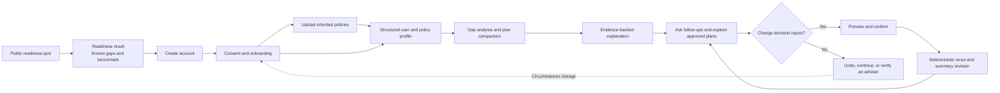
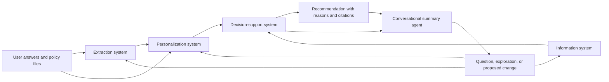

# Project Plan: Singapore Insurance Readiness Guide

**Planning date:** 25 August 2026
**MVP deadline:** Friday, 28 August 2026
**Audience:** First-time working adults in Singapore, primarily ages 19-29
**Working mission:** Help young adults understand inherited insurance, identify coverage gaps, and compare suitable options with evidence they can verify.

This document organizes the requirements in [the IGNITE brief](IGNITE-Agentic-AI-Hackathon-Training-Session.md) and [the initial project notes](SimplyNext%20Hackathon%202026.md). It is a plan only; it does not implement any system.

## Delivery Documentation

- [User Requirements Specification](urs/URS.md): user outcomes, constraints, and acceptance statements.
- [Product Requirements Document](prd/PRD.md): prioritized product behavior, success measures, and requirement traceability.
- [Epic register](epics/README.md): ownership, priority, status, repository evidence, and DOD.
- [Backlog register](backlog/README.md): implementation tickets grouped by epic.
- [Technical diagrams](diagrams/README.md): architecture, workflow, sequence, and ER diagrams.

The current delivery posture is a hackathon POC. Productionisation and security hardening are tracked as a low-priority, deferred epic; baseline safeguards for secrets, synthetic-data labels, and the educational-not-advice boundary still apply.

## 1. Problem Definition

### Evidence-backed problem statement

> A first-time working adult in Singapore who has inherited insurance bought by their parents needs an independent way to understand what they own, what it covers, and whether it still fits their budget, responsibilities, and goals, because inherited policies are often poorly understood and may no longer suit their adult needs.

This follows the IGNITE point-of-view format:

- **Person:** A first-time working adult in Singapore.
- **Moment:** Taking responsibility for policies bought by their parents.
- **Need:** An independent, understandable view of current coverage and gaps.
- **Evidence:** CNA states that many people taking over parental policies do not fully understand what they are paying for or whether coverage still suits their adult needs.

### How might we

> How might we give first-time working adults in Singapore an independent, evidence-backed view of their existing coverage and personal protection gaps, so they can decide whether inherited parental policies still fit their budget and goals?

This wording improves the draft in three ways:

1. It places the desired quality, an **independent, evidence-backed view**, before the proposed outcome.
2. It stays focused on insurance protection rather than the much broader and less provable idea of a complete "financial portfolio."
3. It remains true if the eventual solution is not an AI web application.

### Evidence caution

The linked CNA page supports the inherited-policy comprehension problem, but its accessible text does **not** contain the draft claim that "1 in 4 Gen Zs in Singapore (26%) remain financially unprepared" or that 26% rely on parental insurance.

Do not use the **26%** figure in the problem statement, deck, or demo until the team has the original survey, sample definition, publication date, and exact wording. Do not combine separate claims about parental policies, life-insurance adequacy, and long-term planning into one statistic.

### Why this is worth solving

- A policy can exist without its owner understanding its benefits, exclusions, premium commitment, or fit.
- New workers must reconcile inherited policies with MediShield Life, employer benefits, current income, dependants, debts, and new goals.
- Product comparison is difficult because information is spread across policy documents and provider materials.
- Product sellers may have restricted panels or commercial relationships. Users benefit from transparent sources, recommendation reasons, and conflict disclosures.
- Poorly informed switching can also cause harm: a new policy may not reproduce the old policy's coverage.

## 2. Product Position and Boundaries

### Product promise

The product is an **insurance-readiness education and comparison assistant**. It helps users:

1. Discover what they do and do not know about their coverage.
2. Build a structured profile from explicit answers and uploaded policy documents.
3. See protection gaps and affordable plan categories.
4. Compare plan evidence and understand why an option may fit.
5. Know what to verify before speaking to or buying from an authorized provider.
6. Ask follow-up questions, explore approved alternatives, and safely revise the final comparison as their inputs change.

### Trust boundary

Only authorized firms and individuals may give financial advice on life insurance and investments in Singapore. For the MVP:

- Describe outputs as **educational comparisons**, not regulated financial advice.
- Do not claim that the service is an "independent financial adviser."
- Do not sell, apply for, switch, surrender, or transact on a policy.
- Do not tell a user to cancel an inherited policy.
- Show assumptions, missing data, sources, exclusions, premiums, trade-offs, and recommendation reasons.
- Link users to the MAS Financial Institution Representatives Register before they share information or transact with a representative.
- Use synthetic plans only when visibly labelled **demo data**.
- Obtain legal/compliance review before any real public launch.

### MVP scope

**In scope by Friday:**

- Public readiness quiz with no sign-in.
- Results page with a rule-based score, uncertainty, and clearly labelled peer comparison.
- Account-creation transition; mock authentication is acceptable for the prototype.
- Structured onboarding questionnaire.
- Policy-document upload and OCR demonstration.
- Four agent-system demonstrations using stable data contracts.
- Synthetic plan catalogue and reviewed synthetic user profiles for correctness tests.
- A small, cited real-product retrieval collection for the RAG demonstration.
- Recommendation reasons, alternatives, assumptions, and source citations.
- A visible final-page conversational agent that operates typed tools, explores only approved plans, previews consequential changes, and dynamically updates the comparison after confirmation and deterministic recalculation.
- Evaluation dashboard or report suitable for the deck and video.

**Out of scope:**

- Purchasing, switching, surrendering, or submitting insurance applications.
- A complete financial or investment portfolio.
- Exhaustive coverage of every Singapore insurer and product.
- Production identity, payment, or sensitive medical-data workflows.
- Peer rankings based on invented or statistically weak population data.
- Screenshot-coordinate computer use, arbitrary page code, open-web plan search, or direct model-authored recommendation values.
- Autonomous email to an adviser. Treat this as post-MVP and require explicit user approval.

## 3. User Journey

### Stage 1: Curiosity quiz

The landing page should feel like a polished BuzzFeed-style assessment: fast, visual, and specific. It must not ask for an NRIC, exact salary, medical details, or policy upload.

Suggested 8-question quiz:

1. Can you name every insurance policy currently covering you?
2. Do you know who owns each policy and who pays its premium?
3. Do you know the coverage amount for death/TPD and critical illness?
4. Do you know your hospital plan, ward level, deductible, and co-insurance?
5. Do you know which coverage ends when you leave your employer?
6. Do you know the total annual premium and its share of your income?
7. Could you identify the main exclusions and surrender implications?
8. Would you know how to verify an adviser and compare alternatives before buying?

Result copy should create curiosity without fear:

- Good: "You know the names of your policies, but three details still block a reliable comparison."
- Good: "Pilot participants in a similar age band most often missed employer-coverage expiry."
- Avoid: "You are behind 74% of your peers and could lose everything."

### Stage 2: Account and consent

Explain why more information is required, what will be stored, how documents are processed, and that incomplete answers reduce recommendation confidence. Ask for consent before collecting or retaining policy information.

### Stage 3: Full onboarding

The onboarding profile should adapt the official Singapore Financial Needs Analysis process while collecting only what the MVP needs.

| Section | Questions/data | Why it matters |
|---|---|---|
| Life stage | Age band, residency, employment status, expected job changes | Determines applicable government/employer coverage and horizon. |
| Goals | What to protect or achieve, target amount, target date, priority | Recommendations must map to explicit objectives. |
| Cash flow | Stable take-home income, monthly essential expenses, savings rate | Establishes affordability and resilience. |
| Assets and liabilities | Emergency savings, liquid savings, major debts and repayment periods | Changes the protection gap and ability to sustain premiums. |
| Dependants | Number, relationship, support amount, support duration | Determines income-replacement needs. |
| Existing policies | Insurer, product, owner, life assured, benefits, sums assured, premium, term, riders, exclusions | Prevents duplicate coverage and unsafe replacement. |
| Government coverage | MediShield Life, Integrated Shield Plan, CareShield Life, DPS/HPS where relevant | Establishes the Singapore baseline before adding private cover. |
| Employer coverage | Benefits, limits, and whether coverage ends with employment | Identifies portable-coverage gaps. |
| Health preferences | Ward/doctor preference, income replacement, critical illness and long-term care needs | Maps desired protection to plan features. |
| Product preference | Protection-only versus bundled savings/investment, coverage duration | Prevents mismatched product categories. |
| Affordability | Comfortable premium budget and ability to maintain it if employment changes | A suitable plan must remain affordable over its term. |
| Risk and knowledge | Loss tolerance and product understanding, only if investment-linked products are in scope | Required before considering investment exposure. |

For the hackathon, do not collect detailed diagnoses, NRIC, payment data, or beneficiary identities. Show a notice that medical history affects underwriting and must be disclosed accurately to an authorized provider.

## 4. Insurance Readiness Score

Jana should define and test a single **Insurance Readiness Score (IRS)** from 0-100. It measures readiness to make an informed decision, not wealth, risk, or personal worth.

| Dimension | Weight | Examples of evidence |
|---|---:|---|
| Coverage visibility | 30 | Knows policies, ownership, benefits, premiums, term, riders, and exclusions. |
| Protection foundations | 25 | Understands government/employer coverage and can identify death/TPD, CI, hospital, disability-income, and dependant needs. |
| Affordability and resilience | 25 | Premium burden, emergency fund, debt obligations, and ability to sustain premiums. |
| Action literacy | 20 | Can compare beyond price, verify an adviser, identify free-look rights, and avoid unsafe replacement. |

### Official reference points

Use these as transparent educational benchmarks, not universal prescriptions:

- Emergency fund: **3-6 months of expenses**.
- Death and total permanent disability protection: **9 times annual income**.
- Critical illness protection: **4 times annual income**.
- Protection spending: **at most 15% of income**.
- Retirement and other goal investing: **at least 10% of income**.
- General saving: MoneySense also recommends aiming to save **at least 20% of monthly income**.

The UI must show the source and calculation for every score component. "Unknown" must remain unknown rather than being scored as "no coverage."

### Peer comparison rules

Peer comparison is an engagement experiment, not evidence of suitability.

- Compare knowledge/readiness dimensions, not premium spending or product ownership.
- Segment only on relevant coarse attributes such as age band, employment stage, and dependant status.
- Label early data as **hackathon pilot participants**, never "Singaporeans" or "your generation."
- Do not show a percentile for a cohort smaller than 10; use an official benchmark instead.
- Show sample size and collection date.
- Never fabricate peer data for a live claim. Mock data must be visibly labelled.
- Measure whether the comparison improves follow-through without increasing anxiety or reducing comprehension.

## 5. Four Capability Systems and Summary Agent

The four domain systems should remain short and single-purpose. The conversational summary agent is a visible operator over their typed contracts, while orchestration remains the bounded execution layer rather than another source of financial logic.

### Information system: Darren

**Job:** Retrieve, summarize, and explain current plan information from provider sources.

**Inputs:** Normalized query, user need, product category, effective date.
**Outputs:** Small typed evidence records with source URL, provider, product, field, value, effective/retrieved date, and quoted passage.
**Must not:** Invent missing product terms, silently merge product versions, or make the final recommendation.

Planned components:

- Approved provider/source list and scraping policy.
- Retrieval pipeline and vector store.
- Source versioning and freshness dates.
- RAG answer with field-level citations.
- CompareFIRST as a comparison reference, not as data the team assumes it may freely republish.

### Extraction system: Tim

**Job:** Convert uploaded policy documents into a structured policy record.

**Inputs:** PDF/image plus consent and document type.
**Outputs:** Extracted fields, page/region evidence, per-field confidence, warnings, and unresolved fields.
**Must not:** Guess low-confidence values or send unnecessary personal data to an LLM.

Target fields:

- Insurer, product, policy type, policy owner, and life assured.
- Benefits and sums assured.
- Premium amount, frequency, and payment period.
- Coverage term/maturity and riders.
- Exclusions, deductibles/co-insurance, and surrender implications where present.

The original brief proposed a dedicated Baidu OCR product, but the current POC decision supersedes that proposal: use the configured OpenRouter `5.6 Luna` document adapter and retain a fixture fallback. Do not name an unverified OCR product in the deck.

### Decision-support system: Deborah

**Job:** Match a complete user profile to eligible synthetic plans and explain why.

**Inputs:** Versioned user profile, normalized plan records, and explicit scoring policy.
**Outputs:** Gap analysis, excluded plans with reason codes, ranked eligible plans, trade-offs, assumptions, confidence, and evidence IDs.
**Must not:** Allow an LLM to decide eligibility or numerical coverage gaps by itself.

Use a hybrid decision method:

1. **Deterministic calculations:** Coverage gaps, affordability, horizon, and duplicate coverage.
2. **Hard constraints:** Remove plans that violate budget, required duration, product preference, or scenario eligibility.
3. **Transparent weighted fit:** Rank remaining plans against user priorities.
4. **LLM explanation:** Convert calculated reasons and cited facts into plain language without changing the result.
5. **Alternatives:** Show at least one trade-off or "no recommendation" when data is insufficient.

### Personalization system: Jana

**Job:** Build the user profile, identify missing information, personalize explanations, and update results as goals change.

**Inputs:** Quiz responses, onboarding answers, extracted policy record, and prior user-approved profile state.
**Outputs:** Versioned profile, missing-field questions, readiness score, explanation preferences, and change history.
**Must not:** Infer sensitive facts such as age, health, dependants, or income from free text when they can be asked directly.

Adaptation should be visible: changing a goal, dependant, budget, or policy must update the gap analysis and explain what changed.

### Conversational summary agent: Tim

**Job:** Answer contextual questions and visibly operate the final page through allowlisted typed tools.

**Inputs:** Current conversation, profile, extraction, recommendation, approved catalogue, evidence, summary revision, and user request.
**Outputs:** Cited answer, typed action trace, optional change proposal, confirmation state, and validated summary revision with delta and undo lineage.
**Must not:** Browse arbitrary sources, execute model-authored code or coordinates, alter decision inputs without confirmation, or author canonical calculations, eligibility, or rankings.

Presentation actions such as focusing evidence, sorting, filtering, or temporarily comparing an approved alternative may apply immediately. Profile, canonical comparison, and reviewed extraction changes must show old and proposed values, wait for confirmation, create immutable input versions, and rerun the deterministic decision-support system before the summary changes.

## 6. Shared Data Contracts

Freeze these contracts before agents are integrated.

### User profile

- `profile_version` and `as_of_date`
- life stage, employment, goals, horizons, and priorities
- monthly income/expenses, assets, liabilities, and premium budget
- dependants and support duration
- government, employer, and private coverage
- product preferences and explicitly unknown fields
- consent flags and provenance for every field

### Plan record

- `plan_id`, provider, product, version/effective date, and source URL
- product category and eligibility rules
- benefit definitions, coverage amounts/options, term, and riders
- premiums/illustrations with assumptions
- exclusions, limitations, fees, and surrender implications
- extraction/retrieval timestamp and evidence spans
- `synthetic: true|false`

### Recommendation result

- profile and ruleset versions
- calculated gaps
- eligible and excluded plans with reason codes
- ranked fit components and trade-offs
- assumptions, missing data, and confidence
- evidence IDs for every product claim
- token/tool/iteration metrics for evaluation

### Conversation and summary revision

- conversation, session, message, proposal, action, run, and revision IDs
- active profile, extraction, catalogue, recommendation, formulation, ruleset, evidence, model, prompt, and tool versions
- user request, supported intent, allowlisted tool and target, status, and affected summary regions
- confirmation requirement and outcome plus old, proposed, and applied values
- cited answer, visible before/after delta, undo lineage, and terminal error
- bounded current-session context without raw document bytes, hidden reasoning, or executable page instructions

## 7. Local-First and AWS Technical Plan

The POC must run locally before AWS deployment work begins.

**Local default:**

- Docker Compose starts the web container, backend API container, exactly one continuously running scraper container, PostgreSQL with pgvector, and optional S3-compatible object storage.
- Local configuration and secrets come from an uncommitted `.env`; `.env.example` contains safe placeholders only.
- Amazon Bedrock is selected through `LLM_PROVIDER`, `BEDROCK_MODEL_ID`, and `AWS_REGION` for E11 grounded explanation. OpenRouter remains separately selected through `DOCUMENT_AI_PROVIDER` and `OPENROUTER_MODEL` for E04 policy PDF/image ingestion, OCR, and extraction; its exact model slug still requires confirmation.
- The backend exposes versioned profile, extraction, evidence, recommendation, invocation, conversation, proposal, confirmation, summary-revision, undo, and run-inspection contracts.
- PostgreSQL full-text and metadata retrieval provide the deterministic local baseline; optional semantic embeddings remain behind a provider adapter.

**Later AWS swap:**

- Push the same tested web, API, and scraper images to Amazon ECR.
- Run web and API as ECS Fargate services behind an Application Load Balancer.
- Run the scraper as one ECS Fargate service with desired count one and a database-backed singleton lease.
- Replace local PostgreSQL/pgvector with Amazon RDS for PostgreSQL and local S3-compatible storage with Amazon S3.
- Inject secrets from AWS Secrets Manager and non-secret configuration from ECS task definitions or Parameter Store using the same environment-variable names.
- Send container logs and health/freshness metrics to CloudWatch.
- Use private subnets for API, scraper, and RDS; route outbound provider and approved-source calls through controlled VPC egress.
- Amazon Bedrock is a required E11 provider and uses the boto3 Converse API behind the existing typed contract. AgentCore remains deferred. Local simulated mode must continue without AWS credentials.

Engineering constraints:

- Resolve provider and model IDs from validated environment configuration and record the resolved values per run.
- Treat `allowed_tools` as a security boundary.
- Validate each conversational tool's schema, target, base version, preconditions, idempotency, confirmation state, and permitted summary regions.
- Apply navigation and temporary presentation actions immediately; require explicit confirmation for decision-input and reviewed-extraction changes.
- Let E07 alone calculate gaps, eligibility, fit, ranking, and canonical summary values after a confirmed change.
- Bound every agent loop with a hard state counter.
- Return small typed tool results; keep large documents out of prompts.
- Capture token use on every response.
- Use typed shared state and preserve a `thread_id` only where conversation state is needed.

## 8. Evaluation Plan

### Core acceptance metrics

| Area | Metric | MVP target |
|---|---|---:|
| Quiz | Completion in an observed target-user test | At least 4 of 5 users |
| Quiz | Users who can explain their result | At least 4 of 5 users |
| Peer comparison | Cohort label, sample size, and date displayed | 100% |
| Extraction | Key-field exact-match/F1 on labelled sample documents | At least 0.90 |
| Extraction | Low-confidence fields shown for review rather than guessed | 100% |
| Retrieval | Reviewed answer contains the expected source in top 5 | At least 90% |
| Retrieval | Product claims with a valid citation and effective date | 100% |
| Decision support | Hard-rule violations across reviewed test cases | 0 |
| Decision support | Top category agrees with reviewed ground truth | At least 90% |
| Explanation | Recommendations with reason, trade-off, and assumptions | 100% |
| Reliability | First-pass schema validation | At least 95% |
| Reliability | Agent loops exceeding configured cap | 0 |
| Conversation | Executed actions that use registered schema-valid tools | 100% |
| Conversation | Decision-input or reviewed-extraction mutations applied without confirmation | 0 |
| Conversation | Applied revisions consistent with one deterministic result version | 100% |
| Conversation | Applied revisions successfully replayed and undone in frozen scenarios | 100% |

Use at least 20 synthetic profiles spanning:

- No dependants versus dependants.
- Stable versus unstable income.
- Adequate versus inadequate emergency funds.
- Employer-only versus portable personal coverage.
- Protection-only versus bundled-product preference.
- Tight versus flexible budget.
- Complete versus intentionally missing information.

Deborah and a second reviewer should write the expected plan category and reasons **before** running the agent. This is the ground truth; the model must not grade itself.

### OpenRouter policy-extraction experiment

Show the configured OpenRouter policy-extraction path in the video using the same 3-5 representative synthetic pages used by the evaluation fixtures.

Measure:

- Field accuracy against manually labelled truth.
- End-to-end latency.
- Input/output tokens.
- Estimated cost using recorded usage and current pricing.
- Amount of source text passed into the recommendation context.
- Manual corrections required.

Do not claim accuracy, token, or cost improvements until this test is run. Report document-extraction usage separately from downstream explanation usage.

## 9. Team Plan to Friday

### Tuesday, 25 August: lock scope and contracts

- **All:** Agree on the problem statement, user journey, trust boundary, and four schemas.
- **Tim:** Wireframe quiz -> result -> account -> onboarding -> recommendation journey; provide mock API interfaces.
- **Deborah:** Define the recommendation rules, reason codes, 6-10 synthetic plans, and first 10 ground-truth profiles.
- **Jana:** Finalize IRS rubric, evidence landscape, quiz wording, and user-test script.
- **Darren:** Define approved source list, normalized evidence schema, and smallest working retrieval pipeline.

**Exit gate:** Every agent can consume and return the agreed fixtures without interpretation of another team's internal format.

### Wednesday, 26 August: build isolated vertical slices

- **Tim:** Complete interactive front/back mock flow and document-upload stub; integrate OCR output fixture.
- **Deborah:** Run deterministic recommendation tests; reach zero hard-rule violations on initial cases.
- **Jana:** Test the quiz with at least five target users; revise confusing or manipulative copy.
- **Darren:** Ingest a small source set and return cited evidence for fixed queries.

**Exit gate:** Each owner can demonstrate their component independently with logged input and typed output.

### Thursday, 27 August: integrate and evaluate

- Connect quiz, onboarding, extraction, profile, retrieval, recommendation, and explanation.
- Run all 20 ground-truth profiles.
- Run the OCR baseline experiment.
- Capture schema pass rate, tool success, completion, tokens, latency, loop count, retrieval, and recommendation metrics.
- Integrate E12 contextual Q&A, approved-plan exploration, confirmed change, visible revision delta, replay, and undo after the deterministic path passes.
- Freeze demo data and prepare failure fallbacks.

**Exit gate:** One rehearsable end-to-end scenario and one changed-goal adaptation scenario both pass.

### Friday, 28 August: freeze, rehearse, and record

- Fix only demo-blocking defects.
- Verify a clean setup from the README.
- Capture screenshots and final metrics for the deck.
- Rehearse the five-minute story at least twice.
- Record a backup demo before the final presentation.

**Exit gate:** The submitted project runs as shown, no synthetic data is presented as real, and every numerical claim has a source or test result.

## 10. Five-Minute Demo Story

| Time | Show | Agentic point |
|---|---|---|
| 0:00-0:30 | A young worker inherits policies but cannot explain them. | Evidence-backed problem. |
| 0:30-1:00 | Complete the public quiz and reveal specific unknowns. | Readiness, not fear. |
| 1:00-1:30 | Create an account and state a goal/budget. | Personalization asks rather than assumes. |
| 1:30-2:15 | Upload a sample policy and show OCR fields/confidence. | Extraction acts; compare OCR baseline metrics. |
| 2:15-3:00 | Retrieve current plan evidence with sources. | Information agent uses grounded data. |
| 3:00-3:45 | Show fit, exclusions, reasons, and trade-offs. | Decision support is deterministic and explainable. |
| 3:45-4:30 | Ask for a lower-budget alternative; show the live typed-action trace, preview and confirm the budget change, then highlight the recalculated comparison delta. | Visible, bounded agent operation with deterministic adaptation. |
| 4:30-5:00 | Undo the revision and present measured accuracy, grounding, confirmation, replay, latency, and cost. | Reversibility and technical quality. |

Keep a preloaded scenario and recorded fallback. Do not depend on live scraping during the judged demo.

## 11. Risks and Mitigations

| Risk | Mitigation |
|---|---|
| Product appears to give regulated advice | Use educational language, disclose limits, and route transactions to authorized firms. |
| "Unbiased" becomes an unsupported claim | Publish source coverage, scoring rules, commercial relationships, and known omissions. Use "evidence-backed" until independently audited. |
| Fear-based FOMO harms trust | Compare readiness constructively, label samples, test emotional response, and never shame users. |
| LLM recommendation is inconsistent | Use deterministic rules and calculations; restrict LLM to questions and explanations. |
| Conversational agent exceeds its authority or leaves a partial update | Use allowlisted typed tools, confirmation for decision inputs, immutable versions, atomic revision application, loop caps, replay, and undo. |
| Product data becomes stale | Store source/effective/retrieval dates, version records, and refuse unsupported claims. |
| Scraping breaches terms or robots policy | Maintain an approved source list and cache only permitted content; prefer official/public structured sources. |
| OCR leaks personal data | Minimize fields, redact before external processing, obtain consent, and use synthetic documents in the demo. |
| Users replace useful inherited coverage | Never recommend cancellation; compare old and new benefits/exclusions and flag underwriting risk. |
| Peer comparison is statistically invalid | Enforce cohort minimums, disclose sample size, and default to official benchmarks. |
| Friday integration fails | Freeze contracts Tuesday, fixtures Wednesday, end-to-end integration Thursday, recorded fallback Friday. |

## 12. Definition of Done

The MVP is ready when:

- A first-time worker can complete the full journey without team assistance.
- The result distinguishes known coverage, unknown information, and calculated gaps.
- Uploaded policy fields retain page-level evidence and confidence.
- Every plan claim has a source, date, and synthetic/real label.
- Recommendation eligibility is reproducible from visible rules.
- A changed user goal visibly changes the result for a stated reason.
- The final-page agent answers with evidence, visibly operates only registered typed tools, and searches only the approved catalogue.
- Decision-input and reviewed-extraction changes require confirmation and produce one deterministic, highlighted, reversible summary revision.
- All loops are bounded and key run metrics are logged.
- The README can start the demonstrated build from a clean environment.
- The deck reports measured results, not aspirational percentages.
- The demo clearly shows where the system plans, acts, and adapts.

## 13. Open Decisions

Resolve these before implementation diverges:

1. Confirm the exact OpenRouter model slug represented by **5.6 Luna**.
2. **Resolved 3 September 2026:** Amazon Bedrock is required for live E11 grounded explanation; AgentCore remains deferred.
3. Obtain the original source for the 26% Gen Z claim or remove it entirely.
4. Decide whether real-product recommendations are shown in the demo or whether real retrieval and synthetic recommendation remain visibly separate.
5. Decide the minimum pilot cohort and consent language for peer comparison.
6. Confirm which provider sites permit automated retrieval and reuse.

## 14. Research Sources

- [CNA Money Talks: Your parents bought you insurance - is it still enough today?](https://www.channelnewsasia.com/listen/money-talks/your-parents-bought-you-insurance-it-still-enough-today-6155256)
- [MoneySense Basic Financial Planning Guide](https://www.moneysense.gov.sg/planning-your-finances-well/)
- [MoneySense guide for entrants to the workforce](https://www.moneysense.gov.sg/planning-your-finances-well/first-job/)
- [MoneySense insurance basics](https://www.moneysense.gov.sg/insurance-basics/)
- [MoneySense financial advisory process](https://www.moneysense.gov.sg/financial-advisory-process/)
- [MoneySense: Who can give financial advice](https://www.moneysense.gov.sg/financial-advice-who-you-could-be-dealing-with/)
- [MoneySense: Taking stock of your finances](https://www.moneysense.gov.sg/taking-stock-of-your-finances/)
- [MoneySense: Understanding life insurance](https://www.moneysense.gov.sg/life-insurance/)
- [MoneySense: Understanding health insurance](https://www.moneysense.gov.sg/health-insurance/)
- [CompareFIRST](https://www.comparefirst.sg/wap/homeEvent.action)
- [MAS Financial Institution Representatives Register](https://eservices.mas.gov.sg/rr)
- [Amazon Bedrock AgentCore overview](https://docs.aws.amazon.com/bedrock-agentcore/latest/devguide/what-is-bedrock-agentcore.html)
- [Amazon Bedrock AgentCore Runtime](https://docs.aws.amazon.com/bedrock-agentcore/latest/devguide/agents-tools-runtime.html)