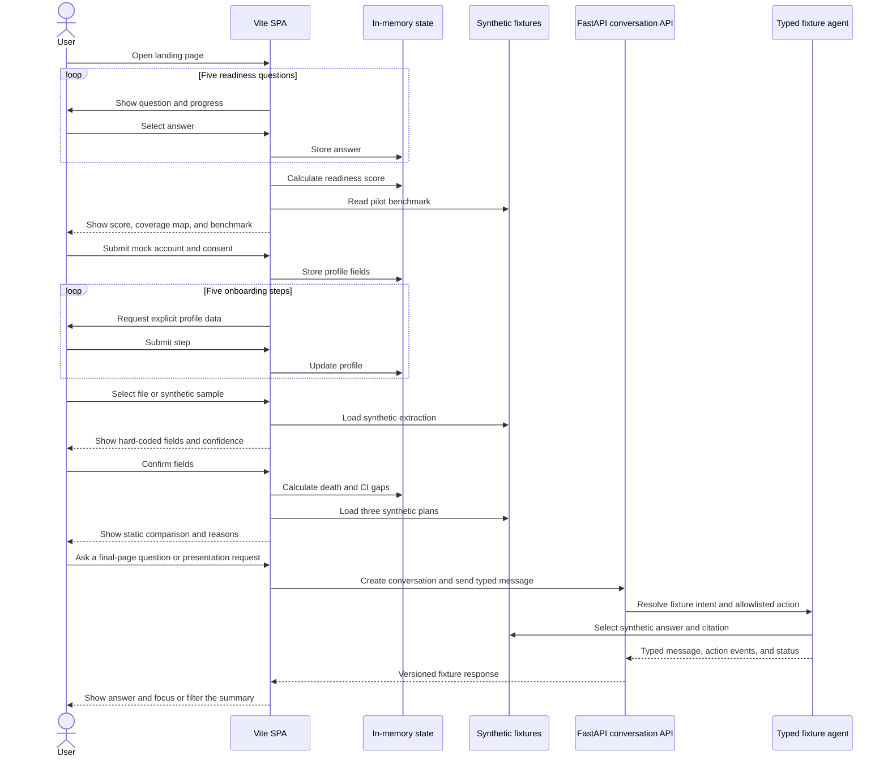
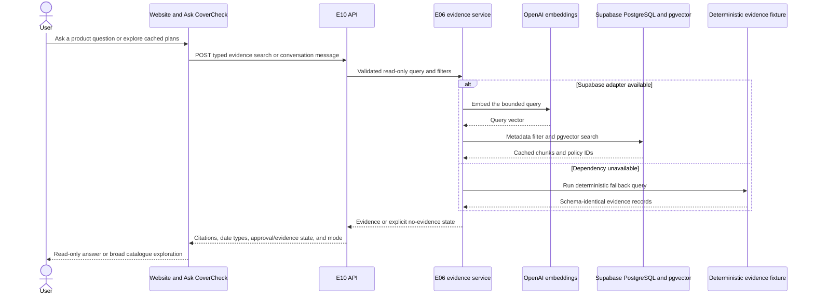
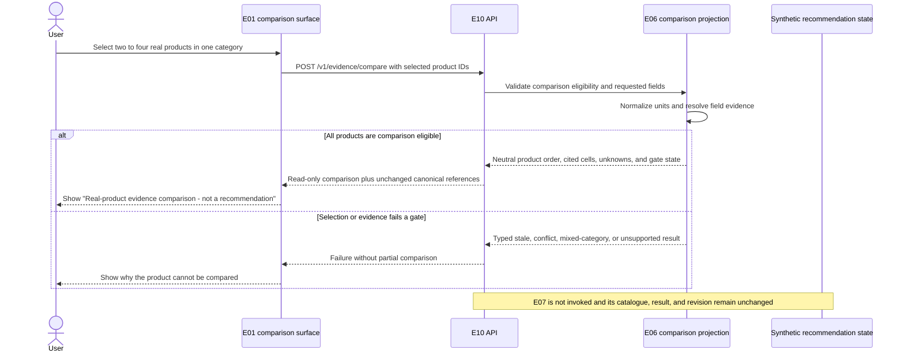
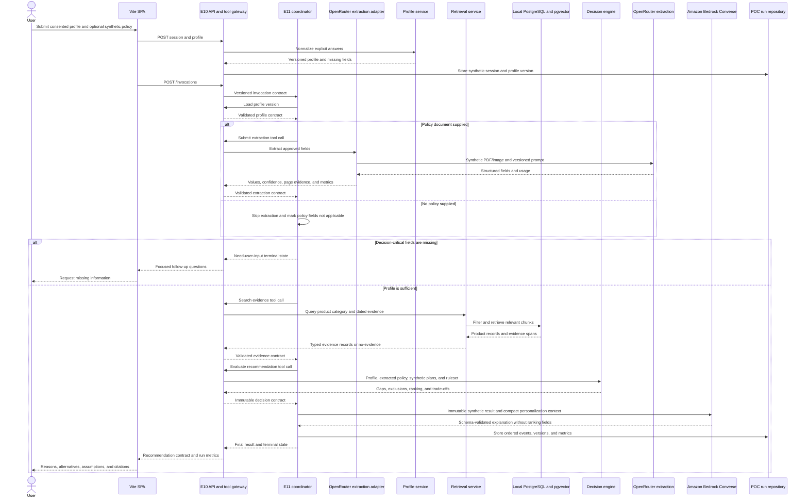

# Sequence Diagram

## Initial browser and fixture-API sequence - 2026-08-26



This records the initial fixture slice accepted on 26 August 2026. At that point, conversation messages left the browser but profile, evidence-search, and recommendation requests did not. The later integrated sequence below supersedes it as the current runtime.

## Initial read-only RAG integration design



This design introduced the direct E10/E06 read path without treating every cached record as approved. The accepted implementation now uses local PostgreSQL as the default adapter, retains Supabase as optional, keeps the three date types distinct, and cannot change the E07 synthetic recommendation.

## Phase 3B real-product evidence-comparison sequence



Phase 3B may follow the direct read-only integration before E11 exists. Discovery relevance can help the user find products, but the comparison uses provider/product ordering and contains no fit score, recommendation badge, or suitability claim.

## Accepted runtime, live Bedrock explanation, and pending OpenRouter extraction

The local API, PostgreSQL evidence path, deterministic E07 engine, invocation coordinator, run events, and typed Bedrock explanation adapter are implemented. Credentialed Bedrock completed through the Docker/Nginx/API path. OpenRouter extraction remains pending; fixture mode supplies the same explanation boundary without a provider credential.



The accepted sequence runs in Docker Compose and uses `.env` configuration. The tested coordinator validates transitions, records Bedrock provider/model/prompt/token metadata, rejects unknown plan IDs, and preserves the deterministic result on provider failure. Credentialed live Bedrock acceptance is complete. Priced cost metrics, full loop-limit acceptance, live OpenRouter extraction, and the later ECS Fargate deployment remain open. AgentCore remains optional.

## Current budget-revision sequence and remaining patch types

```mermaid
sequenceDiagram
    actor User
    participant SPA as E01 final summary and E12 panel
    participant API as E10 conversation API
    participant Coordinator as E11 bounded coordinator
    participant Catalogue as E06 cached catalogue
    participant Profile as E03 profile service
    participant Extraction as E04 extraction review
    participant Rules as E07 deterministic engine
    participant Store as Current-session repository

    User->>SPA: Ask a follow-up or request a page change
    SPA->>API: POST conversation message with active revision

    alt Read-only question or cached-plan exploration
        API->>Catalogue: Validated typed evidence query
        Catalogue-->>API: Dated results with evidence state or no evidence
        API->>Store: Record messages, actions, versions, and metrics
        API-->>SPA: Stream visible actions and answer
        SPA-->>User: Focus, filter, sort, or show temporary alternatives
    else Profile, comparison, or extracted-policy change
        API->>Coordinator: Validated context and allowed tools
        Coordinator-->>API: Typed proposal with old and proposed values
        API->>Store: Save pending proposal and action trace
        API-->>SPA: Confirmation required
        SPA-->>User: Preview impact and request confirmation
        alt User cancels
            User->>SPA: Cancel
            SPA->>API: Reject proposal
            API->>Store: Record rejection; retain active versions
            API-->>SPA: Unchanged canonical summary
        else User confirms
            User->>SPA: Confirm proposal
            SPA->>API: POST proposal confirmation with base version
            API->>Coordinator: Resume validated plan
            alt Profile or canonical comparison patch
                Coordinator->>Profile: Create confirmed immutable version
                Profile-->>Coordinator: New profile version
            else Extraction-field correction
                Coordinator->>Extraction: Create confirmed reviewed version
                Extraction-->>Coordinator: New extraction version
            end
            Coordinator->>Rules: Rerun with versioned inputs and synthetic plan catalogue
            Rules-->>Coordinator: Deterministic result and before/after delta
            Coordinator->>Store: Atomically store run, actions, and summary revision
            Coordinator-->>API: Validated revision and undo lineage
            API-->>SPA: Changed regions and terminal state
            SPA-->>User: Highlight recalculated comparison changes
        end
    end

    opt User chooses undo
        User->>SPA: Undo revision
        SPA->>API: POST undo with active revision
        API->>Rules: Restore or deterministically recalculate prior inputs
        Rules-->>API: Coherent restored result
        API->>Store: Append undo revision
        API-->>SPA: Restored delta and replay record
    end
```

Read-only E06 retrieval and Phase 3B comparison may bypass E11 but not E10 schema validation, comparison-eligibility, or evidence-state rules. Consequential actions enter E11 and select only registered typed tools. Before the separately approved Phase 6 path, model output cannot execute page code or coordinates, search outside the cached E06 corpus, bypass confirmation, place real retrieved products into E07 ranking, or directly author profile versions, extracted values, eligibility, rankings, or displayed decision numbers. Phase 6 still uses E07 deterministically and never lets the model author rank.

The proposal, confirmation, cancellation, deterministic rerun, revision, replay, and undo sequence is accepted for budget changes. Goal, dependant, preference, declared-coverage, and extraction-field changes remain pending and must use the same confirmation boundary before they are claimed.