# User Requirements Specification

## Document control

| Field | Value |
|---|---|
| Product | CoverCheck SG |
| Version | 1.6 |
| Status | POC baseline |
| Date | 3 September 2026 |
| Audience | Product, engineering, research, and hackathon reviewers |
| Source documents | [Project plan](../PLAN.md) and [initial product brief](../OnboardingPrompt.md) |

## 1. Purpose

This User Requirements Specification (URS) defines what first-time working adults and project stakeholders need from the CoverCheck SG proof of concept. It describes user outcomes and constraints without prescribing the implementation.

CoverCheck SG is an educational insurance-readiness and synthetic-comparison assistant for Singapore. Users may start directly with no private plan or an existing plan; the readiness check is optional. It is not a licensed financial adviser and does not transact, replace, surrender, or recommend cancelling policies.

## 2. Problem statement

A first-time working adult in Singapore, including someone with no private policy, needs a clear way to understand their protection starting point and, where relevant, what an existing plan covers. Existing policies may be poorly understood, while product information is difficult to compare and often presented by sellers with limited panels or commercial interests.

## 3. Users and stakeholders

### Primary user

A first-time working adult in Singapore, primarily aged 19-29, who may have inherited policies, employer coverage, limited insurance knowledge, and a new responsibility for premiums and financial decisions.

### Secondary stakeholders

- Hackathon judges evaluating agentic behavior, correctness, evidence, and measurable benefit.
- Team members operating the quiz, extraction, retrieval, recommendation, and demo components.
- Data operators maintaining approved source ingestion, freshness, and retrieval evidence.
- Developers integrating independently owned components through shared contracts and a backend API.
- Authorized financial representatives who may verify information or complete regulated transactions outside the product.

## 4. User assumptions

- The user may not know policy names, benefits, exclusions, premiums, ownership, or employment-related coverage limits.
- Unknown information is valid and must not be treated as no coverage.
- The POC uses synthetic plans and synthetic policy documents unless explicitly labelled otherwise.
- Real-product evidence may be searched or compared only according to its approved evidence state; this does not make it a recommendation.
- Peer results are based only on a labelled hackathon pilot cohort, not the Singapore population.
- The user remains responsible for confirming information with official sources or an authorized representative.

## 5. Functional user requirements

| ID | User requirement | POC priority | Acceptance statement |
|---|---|---:|---|
| URS-FR-001 | The user shall be able to take an optional public insurance-readiness check without signing in. | P0 | Four questions can be started and completed before consent, or skipped in favor of a direct protection route. |
| URS-FR-002 | The user shall receive a repeatable readiness result that distinguishes known, unclear, and missing coverage information. | P0 | Identical answers produce the same score and dimension results. |
| URS-FR-003 | The user shall see a constructive peer or benchmark comparison with cohort label, sample size, and collection date. | P0 | No unlabeled or fabricated population percentile is shown. |
| URS-FR-004 | The user shall give clear consent before providing profile details without being required to create an account. | P0 | Purpose, POC processing, and excluded personal data are shown before onboarding; no name or email is collected. |
| URS-FR-005 | The user shall provide only the minimum fields used by the current decision formulation. | P1 | The common route asks for income, liabilities, goal, product preference, and additional-premium ceiling; the existing-plan route adds four verified current-cover figures. |
| URS-FR-006 | The user shall be told when decision-critical information is unknown and be asked only for information needed to improve the result. | P1 | Missing data is not converted to a negative answer or invented value. |
| URS-FR-007 | The user shall be able to choose a clearly labelled synthetic policy sample; personal-file selection remains a non-processing demo control until document handling is accepted. | P1 | The screen states that the POC does not process the user's real document and offers a safe synthetic route. |
| URS-FR-008 | The user shall be able to review extracted policy fields, confidence, page evidence, warnings, and unresolved values before use. | P1 | Low-confidence fields can remain unresolved or be corrected. |
| URS-FR-009 | The user shall see protection gaps and affordability calculations with their assumptions and Singapore reference points. | P0 | Death/TPD use annual income x 9 plus liabilities; critical illness uses annual income x 4; calculations expose formula intent and draft-review status. |
| URS-FR-010 | The user shall be able to compare eligible synthetic plans or plan categories against their profile and budget. | P0 | Alternatives and excluded options are distinguishable. |
| URS-FR-011 | The user shall receive reasons, trade-offs, assumptions, missing data, confidence, and dated evidence for comparison outputs. | P0 | Every product claim is linked to an evidence identifier or marked synthetic. |
| URS-FR-012 | The user shall be able to change a goal, budget, dependant, or policy and understand why the result changed. | P1 | A material input change reruns analysis and produces a change explanation. |
| URS-FR-013 | The user shall be able to open the MAS representatives register before engaging an adviser or transacting elsewhere. | P0 | A visible verification link is available from the result journey. |
| URS-FR-014 | The user shall be told that outputs are educational, whether data is synthetic, and what the product cannot do. | P0 | Trust-boundary messaging is visible at relevant decision points. |
| URS-FR-015 | The user shall receive an insufficient-data or unsupported result when a reliable comparison cannot be made. | P0 | The system can decline to rank rather than inventing an answer. |
| URS-FR-016 | A data operator shall be able to ingest only approved insurance sources and inspect source version, freshness, and ingest outcomes. | P1 | Every ingested source has an approval record, retrieval status, and timestamp. |
| URS-FR-017 | A developer shall be able to invoke profile, extraction, retrieval, decision, and orchestration capabilities through stable backend contracts. | P0 | Each capability has a versioned request, response, and error contract with representative fixtures. |
| URS-FR-018 | A reviewer shall be able to observe what models and tools acted, whether contracts passed, and what latency, token, cost, retry, and error outcomes occurred. | P0 | A run summary exposes the complete POC execution path and metrics. |
| URS-FR-019 | A reviewer shall be able to replay fixed synthetic scenarios against prewritten expected outcomes. | P0 | Versioned profiles, plans, rules, documents, queries, and expected results can be rerun without manual repair. |
| URS-FR-020 | The team shall be able to switch between live-approved, cached, synthetic, and simulated adapters without changing consumer contracts. | P1 | Every output identifies its data mode and all modes validate against the same schema. |
| URS-FR-021 | A developer shall be able to start the web application, backend API, continuously running scraper, and PostgreSQL/pgvector database with Docker Compose. | P0 | One documented local command starts the four healthy required containers without AWS; object storage remains optional and unconfigured. |
| URS-FR-022 | The system shall use Amazon Bedrock for grounded E11 explanation and a separately configured OpenRouter adapter for policy PDF/image ingestion, OCR, and structured extraction. | P0 | Provider, model or inference-profile ID, and region are selected through configuration; model explanation cannot change the deterministic decision, and extraction retains confidence and page evidence. |
| URS-FR-023 | A user who has no current private policy shall skip upload and continue with existing-policy fields marked not applicable. | P0 | The no-policy path reaches gap analysis without creating coverage facts; Unsure remains a separate unknown state. |
| URS-FR-024 | An operator shall be able to deploy the same web, backend, and scraper container images to AWS without changing application code. | P1 | Deployment changes configuration and managed-service adapters, not capability contracts or business logic. |
| URS-FR-025 | A data operator shall have exactly one continuously running scraper runtime that refreshes due approved sources and exposes freshness and failure status. | P1 | The runtime prevents concurrent active scraper loops and records each source outcome. |
| URS-FR-026 | A reviewer shall be able to inspect the approved mathematical formulation used by plan ranking. | P0 | Every recommendation records the formulation and ruleset versions used to calculate gaps, exclusions, and fit. |
| URS-FR-027 | The user shall be able to ask contextual follow-up questions from the final summary page. | P1 | The conversation retains the active profile, recommendation, evidence, and prior-turn context within the POC session. |
| URS-FR-028 | The user shall be able to ask about approved plans and alternatives not shown in the initial comparison. | P1 | Answers and explored alternatives come only from the approved catalogue and retain source, date, freshness, and synthetic status. |
| URS-FR-029 | The user shall be able to ask the agent to navigate, focus, filter, sort, or otherwise change the summary presentation. | P1 | Harmless presentation changes update the page through visible, allowlisted actions without changing decision inputs. |
| URS-FR-030 | The user shall be able to request changes to profile inputs, canonical comparison plans, or extracted policy fields from the conversation. | P1 | The system shows the proposed changes and requires confirmation before changing any decision input or reviewed policy field. |
| URS-FR-031 | The user shall see the summary update dynamically after an approved request and understand what changed. | P1 | A confirmed request creates a versioned revision, reruns deterministic analysis where required, highlights the delta, and offers undo. |
| URS-FR-032 | A reviewer shall be able to inspect and replay the conversational agent's actions and resulting summary revisions. | P1 | The run exposes ordered intents, tools, evidence, confirmations, deterministic reruns, page revisions, and terminal status. |
| URS-FR-033 | The user shall be able to compare two to four comparison-eligible real products side by side in a clearly non-ranked evidence mode. | P1 | Products come from one category, use neutral ordering, show only source-backed fields, preserve unknown values, and do not change the synthetic recommendation. |
| URS-FR-034 | A reviewer shall be able to determine when a real product is searchable, comparison eligible, or ranking eligible. | P1 | Each state has explicit source, identity, freshness, field-completeness, evaluation, and approval gates; a weaker state never implies a stronger one. |
| URS-FR-035 | An internal user shall receive a deterministic real-product ranking only after the ranked-pilot gate is approved. | P1 | The ranking remains disabled until Phase 5 acceptance, E07 correctness, ranking-eligible data, predeclared E08 tests, and explicit DEC-004/compliance approval are recorded. |

## 6. Non-functional user requirements

| ID | User requirement | POC priority | Acceptance statement |
|---|---|---:|---|
| URS-NFR-001 | Content, currency, public schemes, sources, and terminology shall be appropriate to Singapore. | P0 | Examples use SGD and relevant Singapore guidance. |
| URS-NFR-002 | The journey shall be usable on current desktop and mobile browsers with keyboard-accessible core interactions. | P0 | The POC is responsive and the main path does not require a pointer. |
| URS-NFR-003 | Scoring, gap calculations, eligibility, and ranking shall be deterministic and reproducible. | P0 | Reviewed fixtures produce stable outputs independent of explanation wording. |
| URS-NFR-004 | Product and policy facts shall retain source, date, synthetic status, and field-level provenance where available. | P0 | Unsupported facts do not appear as verified claims. |
| URS-NFR-005 | The POC shall minimize personal data and use synthetic documents; secrets shall not be exposed in the browser or repository. | P0 | The demo requires no real NRIC, diagnosis, payment, or customer policy data. |
| URS-NFR-006 | The judged journey shall run reliably from a documented clean setup and have a recorded fallback. | P0 | The build passes and the rehearsed scenario can be completed within the demo window. |
| URS-NFR-007 | Agent and model activity shall be bounded and measurable. | P1 | Runs expose iteration, latency, error, tool, token, and estimated-cost metrics. |
| URS-NFR-008 | Full production identity, security, privacy, availability, and regulatory controls shall be completed before use with real customers. | P3 | The requirement is tracked but does not block the synthetic POC. |
| URS-NFR-009 | Peer comparison shall avoid shame, unsupported population claims, and statistically weak precision. | P0 | Pilot labels and cohort context are visible, with no fabricated live claim. |
| URS-NFR-010 | Backend and agent failures shall be explicit, typed, bounded, and recoverable without presenting partial output as a valid recommendation. | P0 | Invalid input, unavailable tools, stale evidence, and exhausted retries produce defined failure states. |
| URS-NFR-011 | Independently owned components shall interoperate through versioned schemas and reject incompatible payloads. | P0 | Schema version and validation outcome are available at every component boundary. |
| URS-NFR-012 | Source ingestion and storage shall be repeatable, idempotent, and freshness-aware. | P1 | Reprocessing the same source does not create duplicate active records and stale versions remain distinguishable. |
| URS-NFR-013 | POC results shall be reproducible from recorded fixture, contract, ruleset, model, prompt, and source versions. | P0 | A run can be traced to all inputs and configuration needed to explain or replay it. |
| URS-NFR-014 | Local secrets shall be read from an uncommitted `.env` file and later supplied through AWS Secrets Manager. | P0 | Secrets are absent from source, images, Compose files, browser bundles, and logs in both environments. |
| URS-NFR-015 | Local and AWS environments shall use the same container images and environment-variable contract. | P1 | Switching environments changes endpoints, credentials, and adapters without rebuilding environment-specific application code. |
| URS-NFR-016 | Local state services shall use portable protocols with documented AWS equivalents. | P1 | PostgreSQL/pgvector can move to RDS PostgreSQL and S3-compatible local storage can move to Amazon S3. |
| URS-NFR-017 | Every container shall expose health behavior and shut down cleanly. | P0 | Docker Compose and ECS can detect unhealthy web, API, scraper, database, and storage dependencies. |
| URS-NFR-018 | Conversational page actions shall use allowlisted typed tools rather than unconstrained model-authored page code or coordinate clicks. | P1 | Every action validates against an explicit schema and permission before execution. |
| URS-NFR-019 | Conversational requests shall not bypass deterministic calculation, eligibility, ranking, extraction-review, or evidence rules. | P0 | The model can propose inputs and actions but cannot directly author canonical recommendation values. |
| URS-NFR-020 | Conversation and summary-revision state shall be disposable and limited to the current synthetic POC session by default. | P1 | Starting a new session removes chat and revision history unless a versioned evaluation fixture explicitly retains it. |
| URS-NFR-021 | The conversational interface shall expose progress, evidence, confirmation, failure, completion, and undo states accessibly. | P1 | Keyboard and screen-reader users can follow and control the same action lifecycle as pointer users. |
| URS-NFR-022 | Real-product evidence comparison shall be provenance-complete, neutrally ordered, and isolated from canonical recommendation state. | P0 | Every populated cell has field evidence, source and date state; presentation-only changes leave profile, catalogue, recommendation, and revision versions unchanged. |

## 7. User journey acceptance

```mermaid
flowchart LR
    A[Choose no-plan, existing-plan, or optional readiness check]
    B[Optional result and labelled pilot context]
    C[Consent without account creation]
    D[Provide five decision inputs]
    E{Current private policy?}
    E1[Add four verified figures and review synthetic extraction]
    E2[Continue with policy fields not applicable or unknown]
    F[See calculated gaps]
    G[See synthetic ranked comparison]
    G1[Explore neutral cached real evidence]
    H[Ask follow-up or explore alternatives]
    I{Request a supported change?}
    J[Preview and confirm budget]
    K[Recalculate and update summary]
    L[Replay, undo, or verify adviser]

    A -- Readiness check --> B --> C
    A -- Direct route --> C
    C --> D --> E
    E -- Yes --> E1 --> F
    E -- No or unsure --> E2 --> F
    F --> G --> G1 --> H --> I
    I -- No --> L
    I -- Yes --> J --> K --> H
```

The minimum POC journey is accepted when one target user can complete it without team intervention and can explain the result, its assumptions, and its synthetic or sourced evidence.

## 8. Out of scope for the POC

- Buying, applying for, replacing, switching, or surrendering insurance.
- A complete investment, retirement, or financial-planning portfolio.
- Real customer medical, identity, payment, beneficiary, or policy data.
- Exhaustive whole-market insurance coverage.
- Production authentication, document retention, payments, or adviser communication.
- Claims that the product is an independent financial adviser.
- Real-product ranking before the Phase 6 ranked-pilot gate and public real-product ranking before E09 approval.

## 9. Traceability

Product-level implementation and acceptance criteria are defined in the [PRD](../prd/PRD.md). Epic ownership and delivery status are defined in the [epic register](../epics/README.md). Backlog execution is defined in the [backlog register](../backlog/README.md).