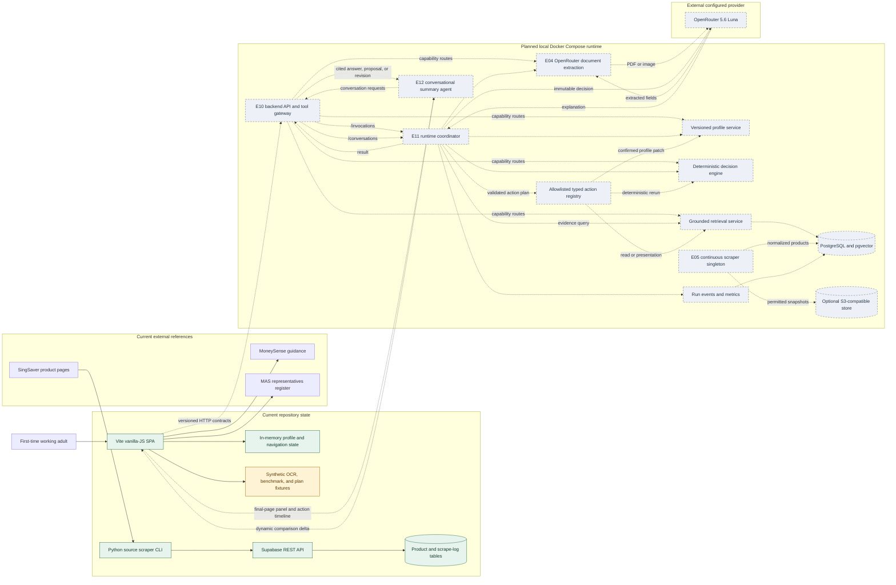

# Capability Architecture

## POC architecture

## Boundary notes

- The current user journey runs entirely in [`frontend/src/main.js`](../../frontend/src/main.js). It does not call a backend.
- Upload, OCR output, the pilot benchmark, and plan recommendations are currently simulated with synthetic values in the SPA.
- [`backend/scraper/card_scraper.py`](../../backend/scraper/card_scraper.py) is a separate working ingestion POC for credit cards; it is not yet an insurance retriever.
- [`backend/scraper/supabase_schema.sql`](../../backend/scraper/supabase_schema.sql) defines the insurance and pgvector foundation, but no frontend or RAG runtime currently consumes it.
- [E10](../epics/E10-backend-api-and-poc-persistence.md) owns transport, shared schema validation, typed errors, and disposable synthetic state; it does not own capability business rules.
- [E11](../epics/E11-runtime-orchestration-and-operations.md) owns the bounded coordinator, OpenRouter runtime integration, and operational coordination; capability services remain independently testable.
- [E12](../epics/E12-conversational-summary-agent.md) owns the final-page agent experience and integration. E11 executes its allowlisted typed tools; E03/E04/E06/E07 retain profile, extraction, retrieval, and deterministic decision authority.
- Navigation, focus, sorting, filtering, and temporary approved-plan exploration may apply immediately. Profile, canonical comparison, and reviewed extraction changes require confirmation, immutable input versions, and a fresh E07 result before the canonical summary changes.
- Model output cannot become HTML, JavaScript, selectors, coordinates, SQL, arbitrary URLs, or canonical recommendation values.
- The local target is Docker Compose with `.env` configuration. OpenRouter `5.6 Luna` handles policy extraction and grounded explanation; the exact model slug remains an explicit configuration decision.
- The implemented Supabase proof remains repository evidence, but the target local application store is PostgreSQL/pgvector so it can later move to RDS PostgreSQL.
- Amazon Bedrock and AgentCore are optional future adapters and are not required for local execution.
- Production identity, durable personal data, private document storage, and operational hardening are intentionally deferred to [E09](../epics/E09-productionisation-and-security.md).