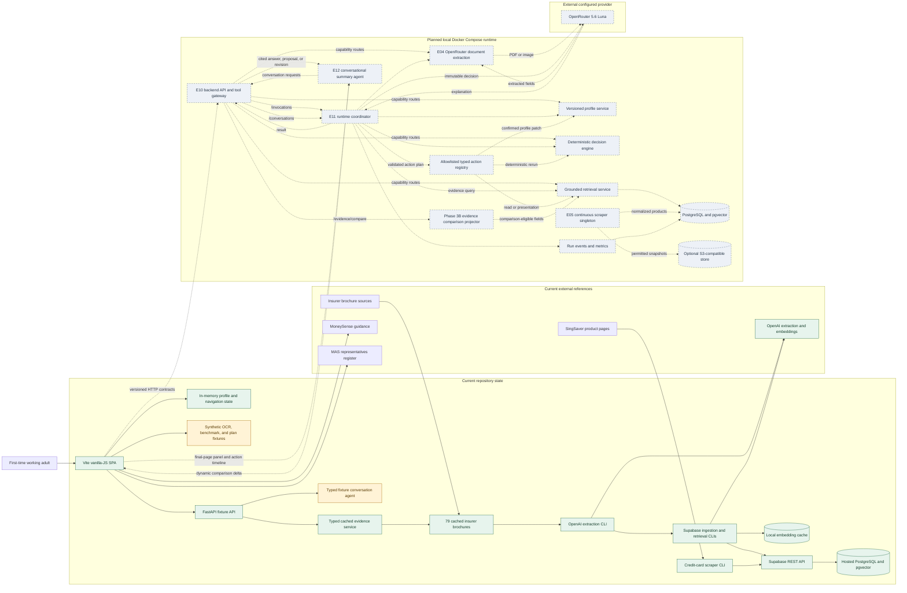

# Capability Architecture

## POC architecture

## Boundary notes

- The current user journey keeps profile, upload, extraction, gap, and recommendation data in [`frontend/src/main.js`](../../frontend/src/main.js), but the final `Ask CoverCheck` panel calls the FastAPI conversation routes in [`backend/app/main.py`](../../backend/app/main.py).
- The conversation and evidence routes now use a typed cached evidence service for cited real-product exploration. They do not alter the synthetic plan ranking.
- Darren's separate RAG slice extracts 79 cached brochures into 87 policy rows, normalizes 71 unique policy slugs, prepares 1,319 candidate chunks, and retrieves typed evidence through a Supabase-backed CLI.
- `CurrentAPI` reads the committed cached corpus through a typed E10/E06 boundary. Supabase remains an optional adapter; local PostgreSQL/pgvector remains the target.
- All cached records may be searched for read-only questions and exploration, but every result carries approval/evidence state and cannot enter E07's synthetic ranking.
- Phase 3B adds a comparison projector for a small comparison-eligible subset. It returns neutrally ordered cited fields and cannot invoke E07 or mutate canonical state.
- OpenAI owns current offline brochure extraction and embeddings. OpenRouter remains the configured E04/E11 provider for user-document extraction and explanation.
- [E10](../epics/E10-backend-api-and-poc-persistence.md) owns transport, shared schema validation, typed errors, and disposable synthetic state; it does not own capability business rules.
- Direct read-only E10/E06 retrieval does not require E11. [E11](../epics/E11-runtime-orchestration-and-operations.md) owns consequential proposals, confirmed changes, deterministic reruns, revisions, replay, undo, OpenRouter runtime integration, and operational coordination.
- [E12](../epics/E12-conversational-summary-agent.md) owns the final-page agent experience and integration. E11 executes its allowlisted typed tools; E03/E04/E06/E07 retain profile, extraction, retrieval, and deterministic decision authority.
- Navigation, focus, sorting, filtering, and read-only cached-plan exploration may apply immediately. Profile, canonical comparison, and reviewed extraction changes require confirmation, immutable input versions, and a fresh E07 result before the canonical summary changes.
- Real-product ranking remains disabled until the separate Phase 6 data, E07, E08, DEC-004, and compliance gates pass. Public ranked mode additionally requires E09 approval.
- Model output cannot become HTML, JavaScript, selectors, coordinates, SQL, arbitrary URLs, or canonical recommendation values.
- The local target is Docker Compose with `.env` configuration. OpenRouter `5.6 Luna` handles policy extraction and grounded explanation; the exact model slug remains an explicit configuration decision.
- Supabase/PostgREST is the first RAG integration adapter because it is implemented. This temporary delivery deviation does not change the target local PostgreSQL/pgvector store or its later RDS PostgreSQL migration.
- Amazon Bedrock and AgentCore are optional future adapters and are not required for local execution.
- Production identity, durable personal data, private document storage, and operational hardening are intentionally deferred to [E09](../epics/E09-productionisation-and-security.md).