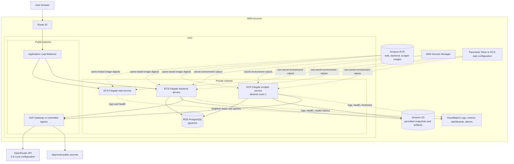

# AWS Target Topology

This is the later migration target for the locally accepted containers. It is not a production deployment claim and does not block the Docker Compose POC.

## Per-module AWS mapping

| Module | AWS services | Migration responsibility |
|---|---|---|
| E01 POC Web Experience | ECR, ECS Fargate, ALB, Route 53; CloudFront is optional later | Publish and run the same web image; configure API origin without embedding secrets. |
| E02 Readiness Quiz | Web task and backend task; CloudWatch for errors | Keep deterministic scoring in application code and contracts. |
| E03 Profile API | Backend ECS task, RDS PostgreSQL, Secrets Manager | Preserve explicit unknown and no-policy states; migrate only repository endpoints and credentials. |
| E04 Policy Extraction | Backend ECS task, S3 for permitted temporary/synthetic objects, Secrets Manager, controlled egress to OpenRouter, CloudWatch | Use the configured OpenRouter adapter; delete uploaded document bytes after extraction by default. |
| E05 Source Ingestion | ECR, one ECS Fargate scraper service task, RDS lease and product tables, S3 snapshots, Secrets Manager, controlled egress, CloudWatch alarms | Set desired count one, retain the singleton lease, and alarm on failures and stale sources. |
| E06 Retrieval and RAG | Backend ECS task, RDS PostgreSQL/pgvector, S3, CloudWatch | Run the same migrations and evidence contract; retain metadata/full-text fallback. |
| E07 Decision Support | Backend ECS task and RDS version records | Keep approved deterministic formulation and rules outside the model; record formulation version. |
| E08 Integration and Evaluation | ECR promotion evidence, ECS task definitions, CloudWatch dashboards, S3 evaluation artifacts | Verify locally accepted image digests and environment mappings before deployment. |
| E09 Productionisation | IAM, KMS, WAF, CloudTrail, Config, GuardDuty, backup and recovery services as later scope | Add production security, resilience, governance, rotation, and regulatory approval after POC validation. |
| E10 Backend and Persistence | ECR, ECS Fargate, ALB, RDS, S3, Secrets Manager, Parameter Store, CloudWatch | Own image, network, health, environment, database, and object-store adapter mappings. |
| E11 Runtime Operations | Backend and scraper ECS services, Secrets Manager, CloudWatch; Bedrock/AgentCore optional | Operate bounded invocation/model calls and scraper lifecycle; keep OpenRouter external through controlled egress. |
| E12 Conversational Summary Agent | Existing web and backend ECS services, RDS current-session records, controlled OpenRouter egress, CloudWatch | Run the final-page panel, typed action policy, confirmation, deterministic revision, replay, and undo contracts without adding an application service. |

## Swap contract

| Local | AWS | Invariant |
|---|---|---|
| `.env` secret values | AWS Secrets Manager task injection | Environment-variable names stay the same. |
| `.env` non-secret values | ECS task definition or Parameter Store | Provider and adapter selection remains configuration-driven. |
| Docker-built images | Amazon ECR image digests | AWS runs the same images accepted locally. |
| Docker Compose application services | ECS Fargate services and tasks | HTTP, health, logging, and termination contracts remain unchanged. |
| PostgreSQL/pgvector container | RDS PostgreSQL/pgvector | Migrations, SQL, and evidence schemas remain portable. |
| S3-compatible local object store | Amazon S3 | Object keys and repository interface remain stable. |
| Local stdout/stderr and health checks | CloudWatch Logs, metrics, and alarms | Applications do not need a separate log-shipping code path. |

Bedrock and AgentCore remain optional future adapters. Adding either must not change the profile, extraction, evidence, recommendation, invocation, conversation, action, summary-revision, or run-event contracts.