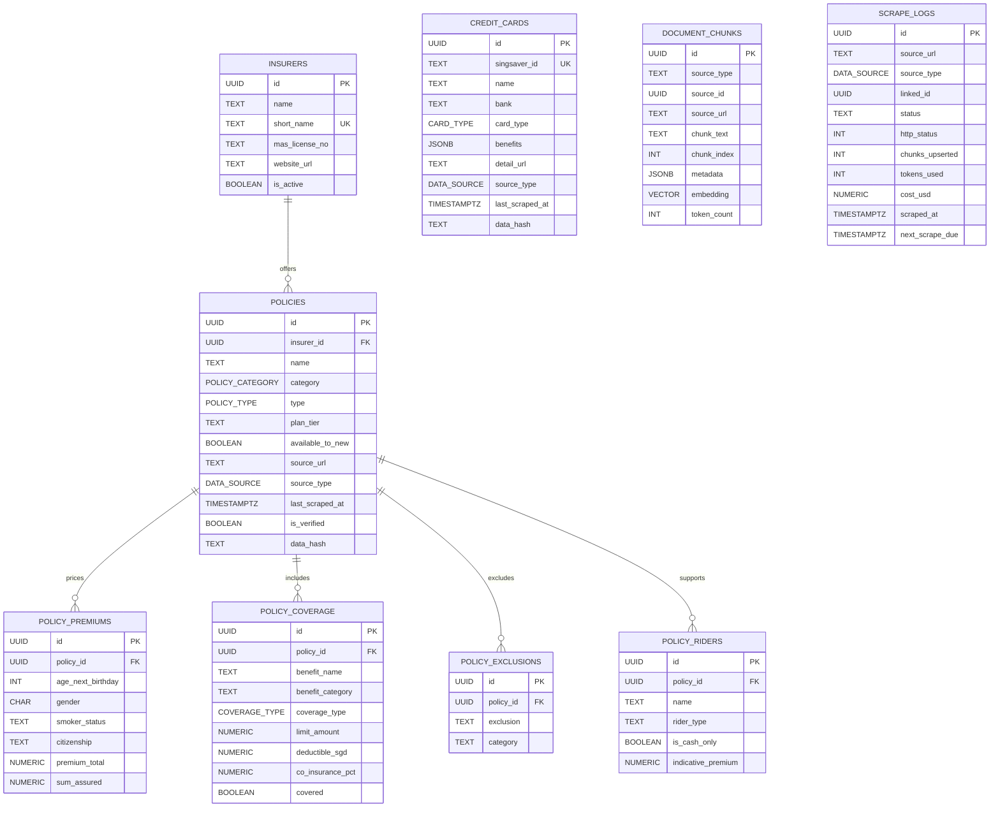
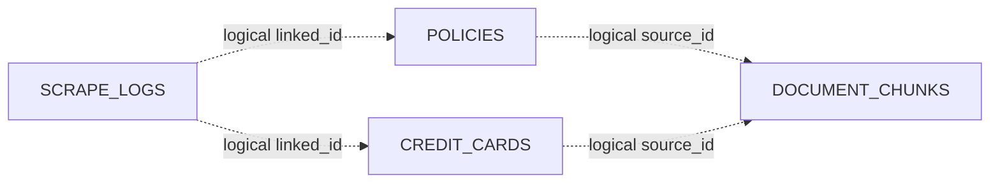
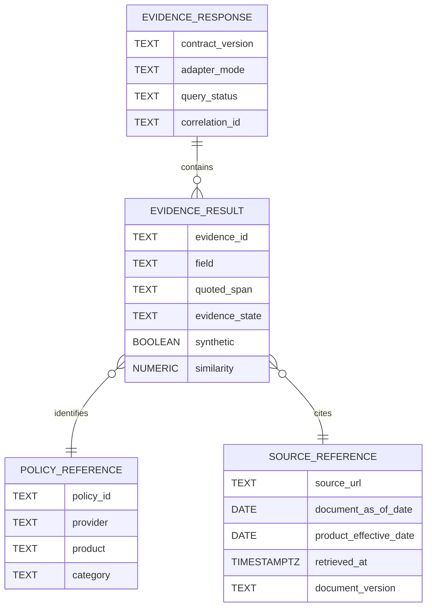
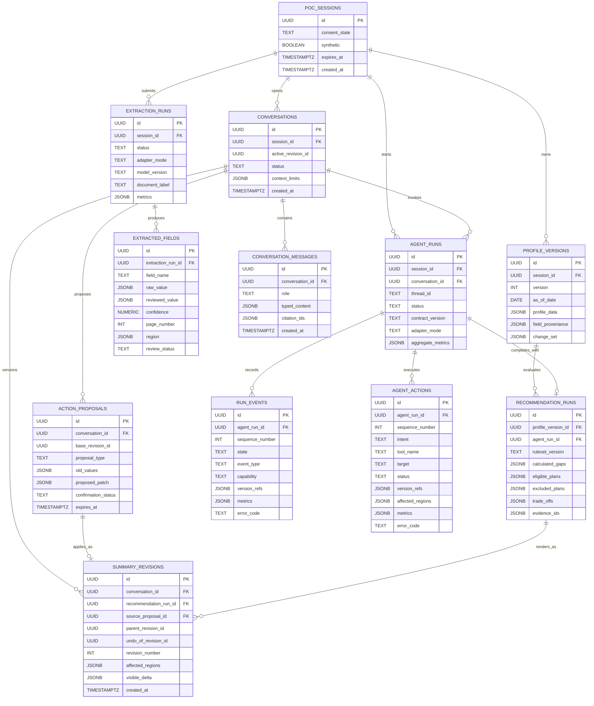

# ER Diagram

## Implemented core RAG schema

This is the core of [`backend/scraper/supabase_schema.sql`](../../backend/scraper/supabase_schema.sql), which the current ingestion and retrieval CLIs consume through Supabase/PostgREST. The diagram omits some normalized support tables for readability. It does not imply that the same schema is wired into E10 or the website.

## Provenance relationships

The solid relationships in the ER diagram are enforced foreign keys with cascading deletes. `document_chunks.source_id` and `scrape_logs.linked_id` are polymorphic logical references and are not database foreign keys.

## Approved read-only evidence contract

The first website integration adds a typed logical contract before any storage migration is chosen. These fields may be derived from existing policy, document, chunk, and metadata records; they are not current SQL-column claims.

`document_as_of_date`, `product_effective_date`, and `retrieved_at` are distinct. Unknown values remain null. `evidence_state` records approval, freshness, conflict, or uncertainty; broad cache inclusion alone never means approved or suitable.

## Proposed POC runtime model

The E10 repository contract adds disposable synthetic workflow state without claiming that these tables already exist.

## Scope notes

- The current RAG CLIs actively consume [`backend/scraper/supabase_schema.sql`](../../backend/scraper/supabase_schema.sql) through hosted Supabase/PostgREST. Hosted database contents still depend on the configured environment and are not a website-integration claim.
- [`backend/scraper/credit_card_schema.sql`](../../backend/scraper/credit_card_schema.sql) is a standalone subset for `credit_cards` and `scrape_logs`.
- User accounts, profile versions, extraction jobs, recommendations, conversations, action proposals, summary revisions, and run events are absent from the current SQL and shown separately as a proposed POC repository model.
- Conversation and revision records are synthetic-only current-session state by default. They retain typed content and version lineage, not raw document bytes, hidden model reasoning, or executable page instructions.
- Presentation-only revisions may retain the same recommendation run; confirmed decision-input or extraction changes reference a fresh deterministic recommendation run. Parent and undo fields are logical self-references.
- The first E10/E06 integration adapter may use the existing Supabase path, with a schema-identical deterministic fixture adapter for fallback. E10 still targets local PostgreSQL/pgvector in Docker Compose; the same migrations later target RDS PostgreSQL/pgvector.
- Permitted source snapshots may use local S3-compatible storage and later Amazon S3; uploaded user document bytes are not persisted by default.
- Production identity and user-data controls remain in [E09](../epics/E09-productionisation-and-security.md).