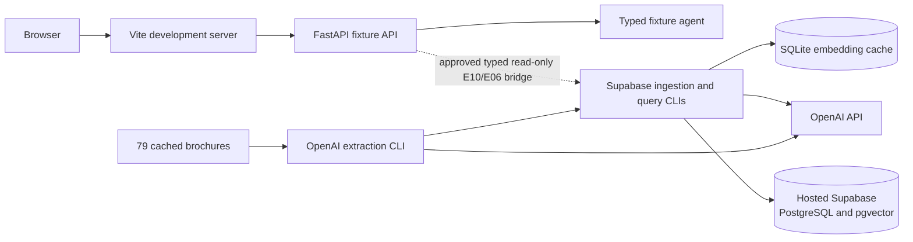
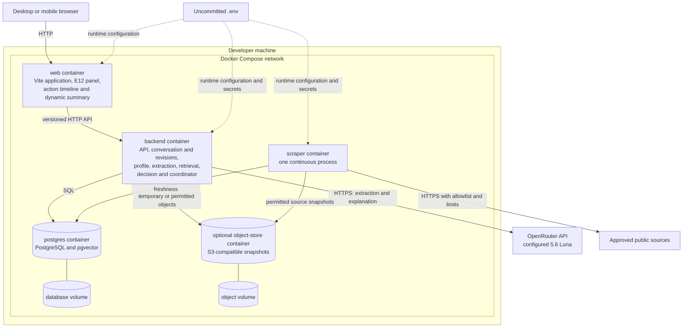

# Local Docker Compose Topology

## Current interim topology

The implemented website/API and RAG paths run separately. Supabase-first integration is an approved temporary delivery step, not the final local deployment target.

The dotted bridge is not implemented. It will sit behind Supabase and deterministic fixture adapters, keep service credentials server-side, expose adapter mode, and return dated evidence states without changing E07's synthetic ranking.

## Target local topology

This is the required POC runtime target. It is planned architecture until the E10 container tickets are implemented.

## Service contract

| Service | Epic ownership | Required health behavior | AWS target |
|---|---|---|---|
| `web` | E01, E08, E10, E12 | Static application, final-page agent, and dynamic summary respond; backend URL is configured | ECR image on ECS Fargate behind ALB, optionally CloudFront later |
| `backend` | E03, E04, E06, E07, E10, E11, E12 | Process, database, object store, provider, conversation, action-policy, and revision modes are reported without secrets | ECR image on ECS Fargate behind ALB |
| `scraper` | E05, E11 | Exactly one loop holds the database lease; last success and source freshness are visible | ECR image on ECS Fargate Service with desired count one |
| `postgres` | E05, E06, E10 | Ready for SQL, required migrations, and pgvector | RDS PostgreSQL with pgvector |
| `object-store` | E04, E05, E06, E10 | Optional S3-compatible endpoint and bucket are ready | Amazon S3 |

## Configuration boundary

Local `.env` contains values such as `APP_ENV`, `DATABASE_URL`, `OBJECT_STORE_ENDPOINT`, `OBJECT_STORE_BUCKET`, `OPENROUTER_API_KEY`, `OPENROUTER_MODEL`, `LLM_PROVIDER`, `DOCUMENT_AI_PROVIDER`, `AGENT_MAX_ACTIONS`, `CONVERSATION_MAX_TURNS`, `SUMMARY_REVISION_LIMIT`, `SCRAPE_INTERVAL_SECONDS`, and `SCRAPE_LEASE_TTL_SECONDS`. Only `.env.example` with safe placeholders belongs in version control.

The web browser never receives provider, database, or object-store credentials. E12 adds no container: it uses the web and backend images plus disposable PostgreSQL session state. Fixture mode must work without an OpenRouter API key.