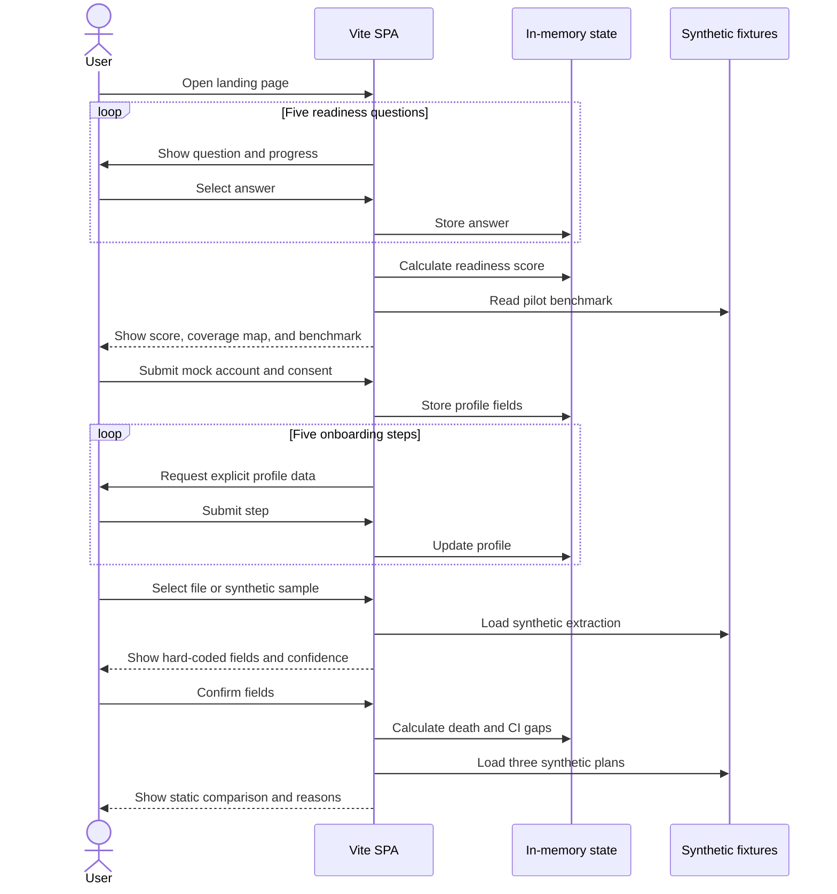
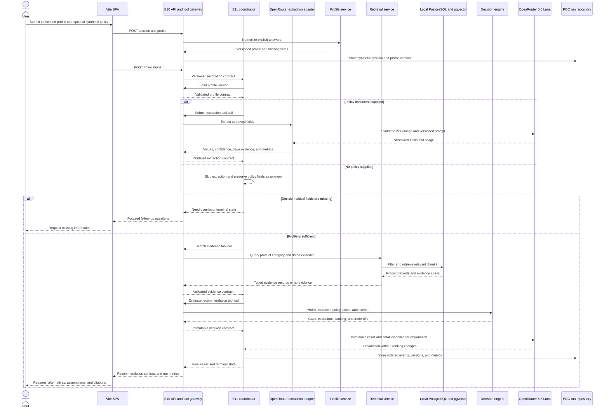

# Sequence Diagram

## Current browser-only sequence



No document bytes, profile data, retrieval request, or recommendation request leave the browser in the current sequence.

## Target local Docker Compose sequence



The local sequence runs in Docker Compose and uses `.env` configuration. Every transition validates its schema, every loop is bounded, and the deterministic decision result is immutable before the OpenRouter explanation call. The same backend image and contract later run on ECS Fargate; Bedrock or AgentCore may be added only as optional adapters.

## Target conversational summary sequence

```mermaid
sequenceDiagram
    actor User
    participant SPA as E01 final summary and E12 panel
    participant API as E10 conversation API
    participant Coordinator as E11 bounded coordinator
    participant Catalogue as E06 approved catalogue
    participant Profile as E03 profile service
    participant Extraction as E04 extraction review
    participant Rules as E07 deterministic engine
    participant Store as Current-session repository

    User->>SPA: Ask a follow-up or request a page change
    SPA->>API: POST conversation message with active revision
    API->>Coordinator: Validated context and allowed tools

    alt Read-only question or approved-plan exploration
        Coordinator->>Catalogue: Search approved records and evidence
        Catalogue-->>Coordinator: Dated cited results or no evidence
        Coordinator-->>API: Cited answer and typed presentation actions
        API->>Store: Record messages, actions, versions, and metrics
        API-->>SPA: Stream visible actions and answer
        SPA-->>User: Focus, filter, sort, or show temporary alternatives
    else Profile, comparison, or extracted-policy change
        Coordinator-->>API: Typed proposal with old and proposed values
        API->>Store: Save pending proposal and action trace
        API-->>SPA: Confirmation required
        SPA-->>User: Preview impact and request confirmation
        alt User cancels
            User->>SPA: Cancel
            SPA->>API: Reject proposal
            API->>Store: Record rejection; retain active versions
            API-->>SPA: Unchanged canonical summary
        else User confirms
            User->>SPA: Confirm proposal
            SPA->>API: POST proposal confirmation with base version
            API->>Coordinator: Resume validated plan
            alt Profile or canonical comparison patch
                Coordinator->>Profile: Create confirmed immutable version
                Profile-->>Coordinator: New profile version
            else Extraction-field correction
                Coordinator->>Extraction: Create confirmed reviewed version
                Extraction-->>Coordinator: New extraction version
            end
            Coordinator->>Rules: Rerun with versioned inputs and approved catalogue
            Rules-->>Coordinator: Deterministic result and before/after delta
            Coordinator->>Store: Atomically store run, actions, and summary revision
            Coordinator-->>API: Validated revision and undo lineage
            API-->>SPA: Changed regions and terminal state
            SPA-->>User: Highlight recalculated comparison changes
        end
    end

    opt User chooses undo
        User->>SPA: Undo revision
        SPA->>API: POST undo with active revision
        API->>Rules: Restore or deterministically recalculate prior inputs
        Rules-->>API: Coherent restored result
        API->>Store: Append undo revision
        API-->>SPA: Restored delta and replay record
    end
```

The model selects only registered typed actions. It cannot execute page code or coordinates, search outside the approved catalogue, bypass confirmation, or directly author profile versions, extracted values, eligibility, rankings, or displayed decision numbers.