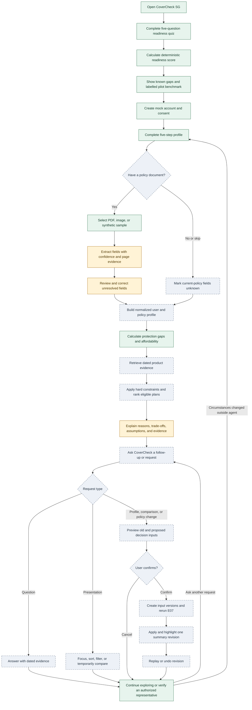

# Workflow Diagram

## User and decision workflow

## Current POC status

| Workflow slice | Current behavior |
|---|---|
| Quiz and result | Implemented in the browser |
| Account and profile | Mock account plus in-memory five-step profile |
| Policy upload | File selection works; document content is not processed |
| No-policy path | Navigation can continue, but the explicit API state and tests are pending |
| Extraction review | Synthetic, hard-coded fields and confidence values |
| Gap analysis | Deterministic death and critical-illness calculations |
| Product retrieval | Not implemented; links and product evidence are embedded |
| Ranking | Static synthetic comparison with a budget rationale |
| Adaptation | User can navigate back, but outputs are not versioned or change-explained |
| Conversational summary | Not implemented; there is no contextual Q&A, typed action trace, confirmation proposal, dynamic revision, replay, or undo |

## Workflow invariant

Unknown values remain unknown. The workflow must return an insufficient-data outcome rather than invent policy terms, eligibility, or user circumstances. Presentation actions cannot mutate canonical inputs, and consequential changes cannot reach the summary without confirmation and a deterministic E07 rerun.