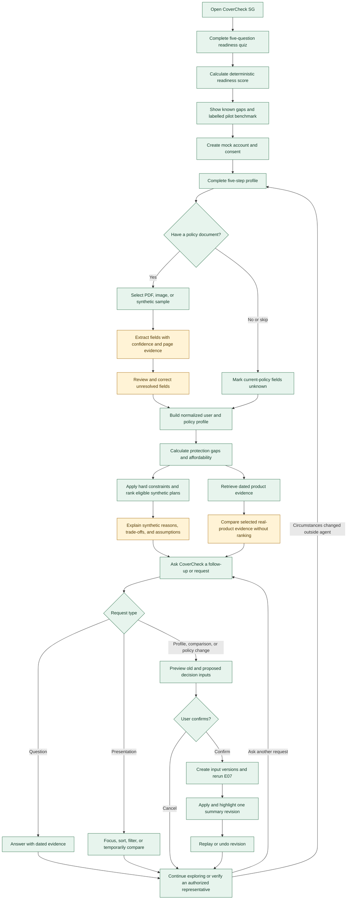

# Workflow Diagram

## User and decision workflow

## Current POC status

| Workflow slice | Current behavior |
|---|---|
| Quiz and result | Implemented in the browser |
| Account and profile | Mock account plus versioned, disposable five-step profile through the API |
| Policy upload | File selection works; document content is not processed |
| No-policy path | The API skips extraction and preserves existing-policy values as unknown |
| Extraction review | Synthetic, hard-coded fields and confidence values |
| Gap analysis | Deterministic death and critical-illness calculations |
| Product retrieval | Local PostgreSQL, cached-corpus, synthetic, and optional Supabase adapters expose one E10 evidence contract; fixed retrieval evaluation remains pending |
| Ranking | API-backed deterministic ranking over the labelled synthetic plan catalogue |
| Adaptation | Confirmed budget changes create immutable profile and summary revisions, rerun E07, show deltas, and support replay and undo; other patch types remain pending |
| Conversational summary | The final-page panel and FastAPI service provide typed Q&A, cached evidence, action traces, focus/filter actions, budget proposals, confirmation, cancellation, revisions, replay, and undo |
| Approved next slice | Phase 3B: compare a small comparison-eligible real-product subset with cited fields, neutral ordering, explicit unknowns, and no effect on E07 synthetic ranking |

## Workflow invariant

Unknown values remain unknown. The workflow must return an insufficient-data outcome rather than invent policy terms, eligibility, or user circumstances. Brochure as-of dates, product effective dates, and retrieval dates remain distinct. Phase 3B real-product evidence is read-only and non-ranked. Real products can enter deterministic ranking only through the separately approved Phase 6 gate. Presentation actions cannot mutate canonical inputs, and consequential changes cannot reach the summary without confirmation and a deterministic E07 rerun.