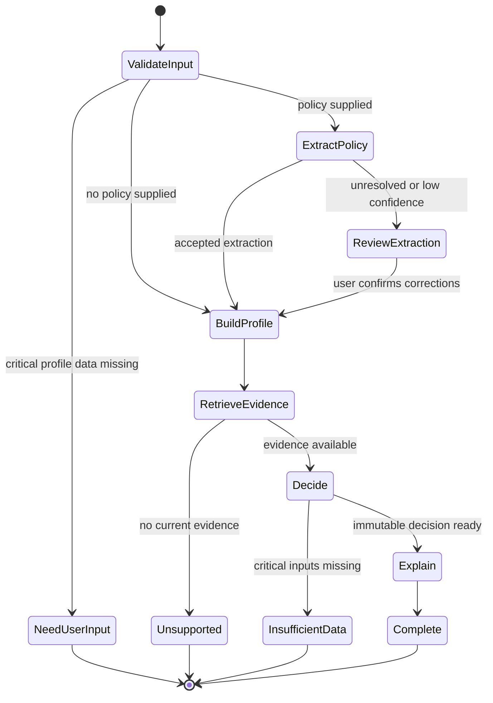

# E11 - Runtime Orchestration and Operations

| Field | Value |
|---|---|
| Primary owner | Jana |
| Priority | P0 |
| Status | Planned |
| Outcome | A bounded local-first runtime coordinates typed capability calls, OpenRouter model work, and one continuously running scraper while remaining deployable to AWS through configuration. |

## Scope

- Run the coordinator with the backend container and expose `POST /invocations`.
- Select OpenRouter `5.6 Luna` through configuration for policy extraction and grounded explanation; keep the exact model slug explicit and auditable.
- Define coordinator states, terminal outcomes, tool allowlists, retry policy, and loop counters.
- Invoke E03, E04, E06, and E07 through E10 contracts and validate every transition.
- Resolve conversational intents and sequence only allowlisted typed read, presentation, proposal, deterministic-rerun, revision, and undo tools.
- Use the model only for document extraction, focused information gathering, and grounded explanation; eligibility, arithmetic, and ranking remain deterministic in E07.
- Emit ordered model, tool, validation, metric, warning, and error events.
- Coordinate one continuous scraper lifecycle: identify due source, acquire singleton lease, fetch, parse, normalize, hash/version, upsert, optionally chunk/index, log, update `next_scrape_due`, retry with bounded backoff, and publish health/freshness metrics.
- Run one scraper container in Docker Compose; later run one ECS Fargate service task with desired count one and retain the database lease.
- Use local `.env` values now and the same environment names from AWS Secrets Manager or task configuration later.
- Treat Amazon Bedrock and AgentCore as optional future adapters rather than local runtime dependencies.

## Requirements traceability

- **URS:** [URS-FR-006, URS-FR-011, URS-FR-012, URS-FR-015, URS-FR-017, URS-FR-018, URS-FR-020, URS-FR-021, URS-FR-022, URS-FR-024, URS-FR-025, URS-FR-027, URS-FR-028, URS-FR-029, URS-FR-030, URS-FR-032, URS-NFR-003, URS-NFR-007, URS-NFR-010, URS-NFR-011, URS-NFR-012, URS-NFR-013, URS-NFR-014, URS-NFR-015, URS-NFR-017, URS-NFR-018, URS-NFR-019](../urs/URS.md)
- **PRD:** [PRD-FR-013, PRD-FR-020, PRD-FR-021, PRD-FR-022, PRD-FR-023, PRD-FR-027, PRD-FR-030, PRD-FR-033, PRD-FR-034, PRD-FR-035, PRD-FR-036, PRD-FR-038, PRD-NFR-005, PRD-NFR-010, PRD-NFR-013, PRD-NFR-014, PRD-NFR-017, PRD-NFR-019, PRD-NFR-021, PRD-NFR-022, PRD-NFR-023, PRD-NFR-024, PRD-NFR-026](../prd/PRD.md)
- **Backlog:** [E11 tickets](../backlog/E11-runtime-orchestration-and-operations.md)

## State model

## Definition of done

- [ ] Docker Compose starts healthy backend, scraper, database, and configured local object-store services without AWS access.
- [ ] The invocation contract accepts a versioned request and returns final state, result, ordered events, and run metrics.
- [ ] Only declared tools execute, every result validates before transition, and raw documents remain outside explanation prompts.
- [ ] Conversational tool policy validates action schema, target, base version, preconditions, idempotency, confirmation, allowed summary regions, and terminal state.
- [ ] Model output never executes as page code, selectors, coordinates, SQL, arbitrary URLs, or direct canonical decision values.
- [ ] Every loop and retry path has a tested cap with `LOOP_LIMIT_REACHED` as a terminal failure.
- [ ] OpenRouter calls record provider, exact model slug, prompt version, tokens, latency, estimated cost, and outcome.
- [ ] Explanation uses the immutable E07 decision contract and cannot mutate rank, eligibility, evidence, or numbers.
- [ ] Live, cached, synthetic, and simulated adapters emit the same contracts and visible mode labels.
- [ ] Exactly one scraper loop runs, retains a database lease, records source freshness, and recovers from bounded failures.
- [ ] The AWS topology maps images to ECR/ECS, PostgreSQL to RDS, snapshots to S3, secrets to Secrets Manager, and logs/metrics/alarms to CloudWatch.
- [ ] Normal, no-policy, missing-information, no-evidence, dependency-failure, changed-goal, and stale-source scenarios reach their expected terminal states.

## POC boundary

This epic coordinates capability calls and runtime lifecycle; it does not grant a model arbitrary application or browser control and does not require AWS to run locally. Production identity, durable conversation memory, multi-region availability, secret rotation, and incident response remain in E09.